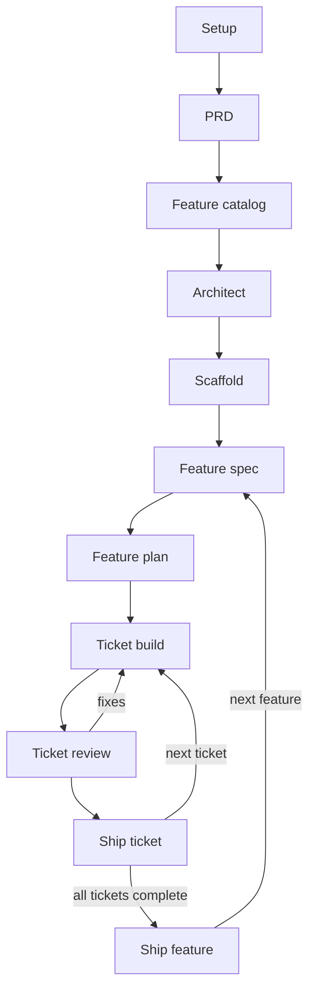

<div align="center">
  <h1>Agenix</h1>
  <p>From an idea to a verified delivery, with context that stays connected.</p>
  <p><a href="#get-started">Get started</a> · <a href="#the-workflow">Explore the workflow</a> · <a href="#browser-tools">Browser tools</a> · <a href="#troubleshooting">Troubleshooting</a></p>
  <small>
    <strong>Author:</strong> Nguyễn Tấn Phát
  </small>
</div>

## Why Agenix?

An AI agent is most useful when it can connect the change in front of it to the decisions, contracts and evidence that came before. Agenix brings reusable skills together into a workflow that carries that context from product definition through delivery.

- **Design before implementation.** Establish requirements, architecture, interfaces and acceptance before breaking work into tickets.
- **Build in verified increments.** Plan tasks, select appropriate verification and preserve evidence as implementation progresses.
- **Review the change in context.** Select review concerns based on the change, then address findings before delivery.
- **Work together with clear boundaries.** Coordinate feature and ticket dependencies, shared contracts and independent work across team members.
- **Keep decisions visible.** Review candidates and evidence at each gate; authorize merges and production exposure separately.

## Get Started

### Prerequisites

- A supported host: [Codex](https://developers.openai.com/plugins/build/plugins), [Claude Code](https://code.claude.com/docs/en/overview) or [Antigravity](https://antigravity.google/).
- A new project in one GitHub-backed Git repository, with an initial default-branch commit and access to create branches and pull requests.
- Git, Python 3.11 or later, and the [GitHub CLI](https://cli.github.com/) (`gh`) authenticated for the target repository. Required GitHub permissions depend on the selected tracker and project policy.
- For browser inspection, Node.js and npm/npx plus a supported Chrome installation, or an explicitly configured compatible browser. Package access may be needed on first use. See [Browser tools](#browser-tools).
- For Jira Cloud tracking, an accessible Jira project and a scoped API token for each developer. Local and GitHub tracking do not require Jira credentials.

### Install the Plugin

Choose your host. These commands configure the plugin in the host; they are not commands to run inside your project application.

<details>
<summary><strong>Codex</strong></summary>

Add the repository marketplace, then install Agenix:

```bash
codex plugin marketplace add phatnguyen975/agenix
codex plugin add agenix@phatnguyen975
```

Check the plugin in your host's plugin interface and start a new session if needed. Marketplace availability and enablement depend on the Codex surface and project trust settings. See [Codex plugin packaging](https://developers.openai.com/plugins/build/plugins).

</details>

<details>
<summary><strong>Claude Code</strong></summary>

In a Claude Code session, add the marketplace and install Agenix:

```text
/plugin marketplace add phatnguyen975/agenix
/plugin install agenix@phatnguyen975
```

Reload plugins with `/reload-plugins` or start a new session if needed. See [Claude Code plugins](https://code.claude.com/docs/en/plugins).

</details>

<details>
<summary><strong>Antigravity</strong></summary>

Install from GitHub using the Antigravity CLI:

```bash
agy plugin install https://github.com/phatnguyen975/agenix
```

Check that Agenix is enabled in the plugin manager. To install from a local checkout, pass its absolute directory to `agy plugin install` instead. See [Antigravity plugins](https://antigravity.google/docs/cli/plugins).

</details>

### Set Up Your Project

Open the target project in your host and invoke setup:

| Host        | First invocation              |
| ----------- | ----------------------------- |
| Codex       | `$agenix:agx-setup configure` |
| Claude Code | `/agenix:agx-setup configure` |
| Antigravity | `/agenix:agx-setup configure` |

The agent prepares a setup candidate and asks about the tracker, project scope, targets and preferred conversation and documentation languages. Review the candidate and close the step with `END AGX-SETUP configure`. If using Jira, enter credentials privately at the path reported by the agent. Then invoke `agx-setup verify` in the same worktree. Verification completes the configuration, presents it for approval and publishes the setup PR. Merge requires a separate decision.

If you are joining a project where setup has already been merged, start with `agx-setup verify` to check your own readiness. To ask how Agenix works at any time, invoke `agx-guide` using your host's skill syntax.

## The Workflow



| Workflow      | What it Does                                                                         | Invocation                                  |
| ------------- | ------------------------------------------------------------------------------------ | ------------------------------------------- |
| **Setup**     | Prepare project settings and verify access.                                          | `agx-setup <configure\|verify>`             |
| **PRD**       | Define the product requirements.                                                     | `agx-prd define`                            |
| **Feature**   | Identify bounded outcomes and dependencies.                                          | `agx-feature define`                        |
| **Architect** | Establish applicable domain, system, stack, data, UI, conventions and test strategy. | `agx-architect <step>`                      |
| **Scaffold**  | Prepare the structure, runtime, services, test harnesses, CI and instructions.       | `agx-scaffold <step>`                       |
| **Spec**      | Define a feature's behavior and applicable API, data and UI contracts.               | `agx-spec <feature-id> <step>`              |
| **Plan**      | Choose delivery boundaries and create tickets.                                       | `agx-plan <feature-id> <strategy\|tickets>` |
| **Build**     | Plan tasks and execute the approved ticket work.                                     | `agx-build <ticket-id> <plan\|run>`         |
| **Review**    | Assess the candidate against its obligations and evidence.                           | `agx-review <ticket-id> assess`             |
| **Ship**      | Deliver a ticket or verify and finalize the feature.                                 | `agx-ship <ticket-id\|feature-id> run`      |

These invocations are skill inputs, not shell commands. Use the host-specific prefix shown above. A feature ID looks like `FEAT-001`; a ticket ID looks like `FEAT-001-T01`. Use the IDs actually allocated in your project. Steps that do not apply to the approved scope are omitted; consult `agx-guide` or the relevant skill for prerequisites and step details.

### Working With a Step

1. **Invoke** one explicit workflow step. The agent starts it with a `BEGIN` marker and uses `DURING` while it remains open.
2. **Review** the candidate, decisions and actual verification results. When you approve a candidate, the agent may perform the stated commit, push and publication actions.
3. **Close** the step with its matching `END` marker. Invoke the next eligible step yourself. A handoff can carry an unfinished step to another session.

Approval of an artifact does not authorize a merge or production exposure. The agent requests separate authority for the exact merge candidate and, when applicable, for exposure. See [workflow control](references/workflow-control.md) and [publication rules](references/git-publication.md).

### Tracking and Teamwork

Choose **local**, **GitHub Issues** or **Jira Cloud** during setup. Feature records and specifications are kept in Git in all three modes. Local tickets contain their tasks in Git; GitHub uses issues and sub-issues, while Jira uses issues and sub-tasks.

Teams can work in separate ticket worktrees. A ticket uses one branch across build, review and fixes; its implementation PR is opened during ticket ship. Fullstack work can be planned as cross-layer slices or as separately delivered tracks coordinated by an approved contract. Feature completion still requires its declared real integration and acceptance checks.

## Browser Tools

Agenix bundles a pinned [Chrome DevTools MCP](https://github.com/ChromeDevTools/chrome-devtools-mcp) configuration for browser inspection. It starts a headless browser with an isolated profile; the project supplies the authorized target and test data. An approved alternative can be used when it provides the required evidence.

The host process needs a compatible Node.js LTS version, npm/npx, access to the pinned package on first use and permission to launch the browser. The server can connect before the browser is launched, so verify both when troubleshooting. Microsoft Edge can be selected through the host-supported server configuration using `--executablePath=<absolute-path-to-edge>`. Do not modify an installed plugin bundle; host override capabilities differ. See [Chrome DevTools MCP configuration](https://github.com/ChromeDevTools/chrome-devtools-mcp/blob/main/docs/configuration.md) and [Microsoft's Edge guidance](https://github.com/MicrosoftDocs/edge-developer/blob/main/microsoft-edge/web-platform/devtools-mcp-server.md).

## Troubleshooting

| Problem                                  | Where to Start                                                                                                                                                                                                          |
| ---------------------------------------- | ----------------------------------------------------------------------------------------------------------------------------------------------------------------------------------------------------------------------- |
| Agenix or `agx-guide` is unavailable     | Check whether the plugin is installed and enabled for the current host/project. Reload plugins or start a new session. Check host policy and project trust.                                                             |
| Browser MCP is unavailable               | Inspect MCP status and logs: Claude Code uses `/mcp`; Antigravity CLI uses `/mcp`; Codex exposes MCP/tool diagnostics in its host interface. A server failure does not by itself establish that the plugin is disabled. |
| MCP connects but the browser fails       | Check Node/npm, package access, browser availability and launch permissions. Use a supported executable override if needed.                                                                                             |
| Jira access fails                        | Verify the configured site and project, token scope and project permissions. Enter credentials privately; do not paste them into chat or commit them.                                                                   |
| A workflow stops or a write is uncertain | Inspect the reported checkpoint, branch, PR or tracker record. Resume the same work and reconcile existing writes before retrying.                                                                                      |

For more detail, invoke `agx-guide` or read the [workflow guide](skills/agx-guide/references/workflow.md) and [plugin troubleshooting guide](skills/agx-guide/references/troubleshooting.md). For host-specific installation and configuration, consult the official host documentation linked above.

## Skills and License

See the [skill catalog](skills/README.md) for workflow, capability and imported skills, including upstream sources and licenses. Agenix is distributed under the [MIT License](LICENSE); imported skills retain their own licenses and notices.
