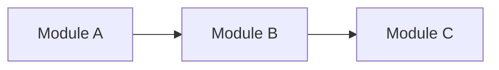

<!--
OUTPUT TEMPLATE — Full Codebase Design

Use when a full, persistent design document is explicitly requested. This is a
living description of the proposed or approved source-code structure.

Filling Rules
1. Keep the ten numbered top-level sections. Include relevant subsections;
   write 'Not applicable — <Why this section does not apply>' for a required
   but inapplicable section. Omit optional subsections that add no value.
2. Text inside <...> is a filling instruction, not a literal output value.
   Replace each placeholder with project-specific content, remove instructional
   comments, and delete unneeded sample rows or entries. Repeat rows, forces,
   decisions, module groups, and migration steps for all applicable items.
3. Use actual project names, paths, language/framework conventions, and
   documented authorities. Distinguish Observed current state, Specified project
   constraints, Proposed target choices, and Unverified claims. Record the
   decision status separately: Proposed, Pending Approval, Approved, Superseded.
4. Obtain the Human Gate described in SKILL.md for material discretionary design
   choices. Approval of a design does not authorize source changes.
5. Use stable, unique DR-xx / CV-xx / EN-xx IDs throughout this living document;
   link every DR/CV rule to at least one EN entry (including an explicit gap).
   Use G-xx for observed migration gaps and link to findings when applicable.
   Example IDs below are illustrative: assign or retain IDs consistently.
6. Show only meaningful directories, modules, tests, constraints, and release
   units; do not invent them to fill the template.
-->

# Codebase Design: <Project Name>

## 1. Scope and Design Forces

<!-- State the design objective, repository or selected-unit scope, exclusions,
     applicable constraints, and whether this is a greenfield design or an
     evolution of existing structure. Identify any authoritative baseline. -->

<Design goal, in-scope repositories or units, exclusions, constraints, and existing baseline>

- **Overall Design Status:** <Proposed, Pending Approval, Approved, or Superseded>.
- **Decision Authority:** <Approver and approval record, or decision owner if approval is pending>.

### 1.1 Release Units

<!-- One row per actual or proposed independently deployed, distributed, or
     published unit, including a sole unit in a single-unit repository. Describe
     build-only packages under their owning release unit. Use short relative
     paths/names; if a release boundary needs a longer explanation, add a brief
     paragraph below the table for that specific unit. -->

| Unit        | Role        | Ships              | Owner   |
| ----------- | ----------- | ------------------ | ------- |
| <Unit name> | <Unit role> | <Release boundary> | <Owner> |

### 1.2 Design Forces

<!-- Repeat one bullet for EACH significant force, not one for each decision.
     Include the evidence and what it means for source organization. Examples
     include independent consumers, change locality, ownership, framework
     restrictions, release cadence, and integration volatility. -->

- **<Design force, such as independent releases or change locality>:** <Relevant evidence and how this force constrains code organization>.

### 1.3 Key Design Decisions

<!-- Repeat one decision record for EACH material discretionary choice. Multiple
     forces can support one decision and one force can affect several decisions.
     Do not duplicate the detailed module/rule catalog later in this document.
     If no discretionary choices exist, cite the governing design authority. -->

**<Architectural decision being made>**

- **Choice and Rationale:** <Selected approach and the forces that justify it>.
- **Alternative and Trade-Off:** <Viable alternative, why it was not chosen, and cost of the decision>.
- **Status and Authority:** <Decision status and approver, or pending approval reference>.
- **Revisit Trigger:** <Specific trigger for revisiting the decision, or Not applicable>.

## 2. Repository Layout

### 2.1 Repository Strategy

<!-- Describe the chosen or retained monorepo, multi-repository, or hybrid
     arrangement and its implications for access, ownership, build coordination,
     shared code, and independent releases. Do not infer release boundaries from
     directory placement alone. -->

<Repository strategy, affected release units, rationale, and meaningful trade-offs>

### 2.2 Root Layout

<!-- Show one annotated tree per relevant repository. Include meaningful unit,
     shared-package, tooling, generated-source, and documentation roots only.
     For an existing repository, mark changes as proposed rather than observed. -->

```text
<Repository root name>/
├── <Release unit path>/            # <Unit responsibility>
├── <Shared package path, if any>/  # <Shared responsibility and owner>
└── <Support directory path>/       # <Tooling or documentation purpose>
```

## 3. Code Organization Strategy

### 3.1 Primary Organization

<!-- Repeat one row per release unit or group of units using the same approach.
     State the dominant grouping (capability, component, layer, use case, or
     justified hybrid), not every directory detail. Explain non-obvious hybrids
     or significant trade-offs in prose below the table only when necessary. -->

| Unit        | Primary Grouping | Decisive Driver | Trade-Off   |
| ----------- | ---------------- | --------------- | ----------- |
| <Unit name> | <Grouping>       | <Main driver>   | <Trade-off> |

### 3.2 Internal Structure Patterns

<!-- Include only modules whose internal pattern materially affects design.
     Examples: simple module, layered, ports and adapters, vertical slice,
     pipes and filters, presentation-state separation. Patterns may combine;
     a pattern name does not imply a required directory structure. -->

| Module / Group    | Pattern(s)   | Reason   |
| ----------------- | ------------ | -------- |
| <Module or group> | <Pattern(s)> | <Reason> |

### 3.3 Unit Layouts

<!-- Repeat one annotated tree for each materially distinct release-unit layout.
     Show architectural modules, intended entry points and framework-required
     locations; avoid exhaustive file inventories. -->

**<Release unit name>**

```text
<Release unit root path>/
├── <First module path>/    # <Responsibility and visibility>
└── <Another module path>/  # <Responsibility and visibility>
```

### 3.4 Pattern-Specific Layouts

<!-- Include a focused tree for each important internal pattern not already
     clear in the unit layout. Omit this subsection if no extra detail helps. -->

**<Module name> — <Pattern or combination of patterns>**

```text
<Module root path>/
├── <Internal area path>/          # <Responsibility and visibility>
└── <Another internal area path>/  # <Responsibility and dependency direction>
```

## 4. Module Catalog

<!-- Repeat a numbered subsection (4.1, 4.2, ...) per release unit or separately
     governed shared package. The group owner is the default; mark exceptions
     explicitly. Allowed dependencies are DIRECT permitted static source/type
     imports or declared build edges, not observed imports or runtime calls.
     Use short module names or dependency-group IDs inside cells; write
     'Internal only' when no cross-module surface exists. -->

### 4.1 <Release unit or separately governed shared package>

**Owner:** <Team or role accountable for this unit and its module boundaries>.

**Catalog:**

<!-- Add one row per module. Use concise names or identifiers. Allowed dependencies
     represent permitted static source/type imports or declared build edges, not
     observed imports or runtime calls. -->

| Module        | Responsibility                                | Public Surface                              | Allowed Dependencies                     |
| ------------- | --------------------------------------------- | ------------------------------------------- | ---------------------------------------- |
| <Module name> | <Primary responsibility owned by this module> | <Public API, entry point, or Internal only> | <Direct permitted dependencies, or None> |

**Dependency Graph:**

<!-- Include a Mermaid diagram when it makes dependency direction easier to understand.
     Replace the example nodes and edges below with the actual permitted dependencies.
     Use separate diagrams if source and build dependency graphs differ. Remove this
     subsection when the catalog is sufficient. -->



<!-- Each arrow A → B means A may statically depend on B. The diagram must agree with
     the catalog and dependency policies in Section 5. -->

**Boundary Notes:**

<!-- Include only details not adequately represented by the catalog or diagram,
     such as protected implementation boundaries, ownership exceptions, or special
     public-surface constraints. Remove this subsection when unnecessary. -->

- **<Module or boundary name>:** <Specific boundary constraint, affected consumers, or ownership exception>.

## 5. Dependency Rules

<!-- Define cross-cutting dependency constraints and exceptions not fully
     captured by the module-specific allowlists in Section 4. Specify the
     scope, dependency type, constraint, enforcement, and approval status
     for each rule. Repeat one record per rule. Do not duplicate dependency
     diagrams or allowed edges from Section 4. If module allowlists are
     sufficient, state that no additional rules are needed and reference
     their enforcement in Section 9. -->

**DR-01 — <Short, descriptive name of the dependency rule>**

- **Scope:** <Release units, modules, or dependency boundaries governed by this rule>.
- **Dependency Type:** <Static source/type imports, declared build dependencies, or other explicitly defined dependency relationships>.
- **Constraint:** <Required or forbidden dependency directions, visibility restrictions, cycle policies, or other enforceable conditions>.
- **Enforcement:** <Related EN IDs from Section 9, or an explicit enforcement gap if no check exists>.
- **Status / Authority:** <Approval status and the decision or authority supporting it>.
- **Exception:** <Affected scope, justification, responsible owner, and review or expiry condition; omit if none>.

## 6. Shared Code and Contract Policy

### 6.1 Shared Modules and Packages

<!-- Repeat one record for each intentionally shared module or package.
     Record its owner, users, intended public access, and release obligations.
     Independently published shared libraries also appear in Section 1.1.
     Omit this subsection when there is no cross-boundary shared code. -->

**<Shared module or package name>**

- **Responsibility / Owner:** <Single responsibility and accountable owner>.
- **Consumers / Public Surface:** <Intended consumers and exposed API or contract path>.
- **Compatibility / Release Policy:** <Compatibility, versioning, and release obligations, or Not applicable>.

### 6.2 Ownership and Compatibility Policies

<!-- Repeat one CV record per substantive governance rule, such as consumer
     review, shared ownership, versioning, contract-source ownership, or release
     compatibility. Import restrictions belong in Section 5. Do not impose
     versioning rules on non-published implementation details. -->

**CV-01 — <Shared code or compatibility policy name>**

- **Policy / Scope:** <Required policy and the shared boundary to which it applies>.
- **Owner / Consumers:** <Policy owner and relevant consumers>.
- **Compatibility / Verification:** <Compatibility obligations and who verifies them>.
- **Enforcement:** <Related EN IDs, including an explicit enforcement gap if no check exists>.
- **Status / Authority:** <Proposed or approved status and authorizing decision>.

## 7. Structural Conventions

<!-- Define only conventions that matter to codebase boundaries: names/public
     entry points, error translation, dependency composition, configuration,
     state ownership, logging boundaries, assets, and generated sources. Use
     the project's language/framework idioms. Repeat one record per convention;
     group related records under an optional topic heading if there are many. -->

**CV-02 — <Structural convention name>**

- **Scope / Convention:** <Affected paths or modules and the convention they must follow>.
- **Owner / Exceptions:** <Responsible owner and bounded exceptions, or None>.
- **Enforcement:** <Related EN IDs, including an explicit enforcement gap if no check exists>.
- **Status / Authority:** <Proposed or approved status and authorizing decision>.

## 8. Test Layout

### 8.1 Test Placement

<!-- Repeat per applicable test boundary (module, integration, contract, E2E,
     etc.). Select types justified by this codebase; not every release unit
     needs every test type. Use concise relative paths. -->

| Boundary   | Type        | Location    | Owner   |
| ---------- | ----------- | ----------- | ------- |
| <Boundary> | <Test type> | <Test path> | <Owner> |

### 8.2 Test Support and Execution

<!-- State how fixture/double ownership and visibility work, and when relevant
     structural tests run (local, pre-merge, release). Do not invent passing
     results or require production modules to import test-only utilities. -->

- **Fixtures and Test Doubles:** <Location, ownership, and visibility of fixtures and test doubles, or Not applicable>.
- **Execution Boundaries:** <When relevant structural tests run and which checks they cover, or Not applicable>.

## 9. Enforcement

<!-- Repeat one EN record for every unique EN ID referenced in Sections 5–7.
     An EN entry may cover multiple rules; a rule can have several EN entries.
     Specify the actual mechanism, not only 'CI'. Distinguish whether a check
     exists from whether it has actually run. Record an explicit gap when
     enforcement is absent. -->

**EN-01 — <Enforcement check or review name>**

- **Rules / Coverage:** <Covered DR/CV rule IDs, modules, paths, and edge types>.
- **Mechanism / Stage:** <Executable check or focused review criterion and execution stage>.
- **Owner / Implementation Status:** <Responsible owner or unassigned>; <Active, Planned, or Gap>.
- **Execution Evidence:** <Passed, Failed, Not Run, or Blocked, with evidence or reason>.
- **Limitations / Exceptions:** <Known blind spots or explicitly bounded exceptions, or None>.

## 10. Migration Plan

<!-- Use only when changing an existing structure. For greenfield or unchanged
     design, state 'Not applicable — ...' and omit subsections. A proposal may
     contain planned steps without implying permission to execute them. The
     Review Template contains recommendations, not a detailed migration plan. -->

### 10.1 Current-to-Target Gaps

<!-- Repeat one gap per evidenced structural difference that needs action.
     Tie each gap to observed paths/edges, the desired boundary, and relevant
     finding/rule IDs. A stylistic difference need not be a violation. -->

**G-01 — <Observed gap or required structural change>**

- **Observed State / Evidence:** <Observed paths or edges and supporting evidence>.
- **Target State / Rule:** <Proposed target boundary and relevant DR/CV rule IDs>.
- **Affected Consumers / Risk:** <Affected consumers, compatibility needs, and release risks>.

### 10.2 Migration Steps

<!-- Repeat the numbered item for each dependency-ordered step. Record what
     changes, when it is safe to proceed, how to verify the declared scope,
     and how to recover (source rollback and release recovery may differ).
     Report executed results separately from planned verification. -->

1. **<Migration action in dependency order>** — <Proposed, In Progress, Blocked, or Complete>.
   - **Scope / Prerequisites:** <Affected paths, consumers, approvals, and prerequisites>.
   - **Change / Expected Dependency Delta:** <Planned structural change and expected dependency delta>.
   - **Addresses / Owner:** <Related G, DR, or CV IDs>; <Owner of this step>.
   - **Verification / Evidence:** <Acceptance checks and observed result, or Not Run if only planned>.
   - **Compatibility / Recovery:** <Compatibility window, source rollback, and release recovery when applicable>.
