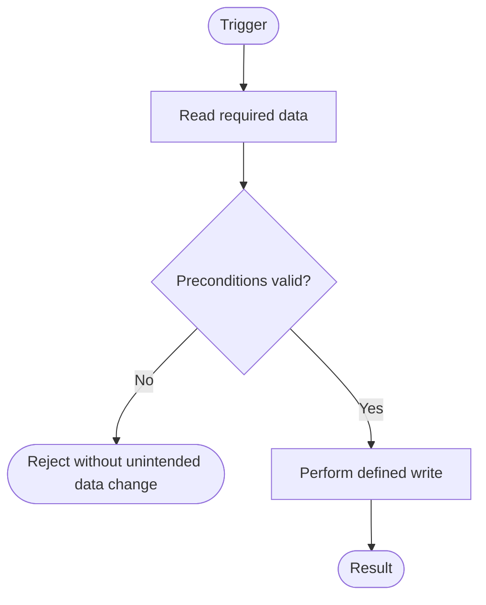
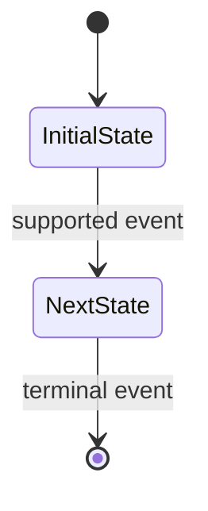

# Data Impact: <Feature Name>

> **How to complete this document:** Keep all nine sections and their order. Replace every `<...>` prompt with evidence-based content and remove this instruction. Do not leave angle-bracket prompts in the final document. Use the exact identifiers from source documents. Define a fact once and reference its `SRC-xx`, `OP-xx`, `AP-xx`, or `DMC-xx` elsewhere. Use `None` only after considering an item and determining it is absent/not applicable; use `Unknown — <what is missing and why it matters>` when evidence is insufficient. Do not invent data. All flow and state diagrams use fenced Mermaid blocks. Tables may be extended as needed; do not combine multiple unrelated facts into a single unreadable cell.

## 1. Overview

### Feature context

- **Feature:** <Feature Name>
- **Feature slug:** <lowercase-kebab-case>
- **Datastores:** <For each store: technology/type, role, and structures owned; state Unknown when not established>
- **Feature Specification:** <path/reference and relevant sections>
- **UI Specification:** <path/reference and relevant sections / None — not supplied or not applicable>
- **System Data Model Document:** <all relevant paths/references>
- **Project conventions / architecture references:** <path/reference / None found after searching the relevant documentation>

### Source register

> One row per source that supports a data requirement, existing-model fact, constraint, access pattern, or decision. Use stable source IDs even when the source lacks its own requirement ID. Include a path plus heading/line/requirement ID where available. Distinguish direct source facts from approved assumptions.

| Source ID | Source type and location                              | Relevant passage / requirement | Evidence status                                         |
| --------- | ----------------------------------------------------- | ------------------------------ | ------------------------------------------------------- |
| SRC-01    | <Feature spec path, section, line, or requirement ID> | <Concise faithful statement>   | <Confirmed fact / user-approved assumption / inference> |

### Data requirements and traceability

> One row per data-relevant requirement or rule. Disposition must identify the OP, existing model element, DMC, AP, constraint, lifecycle transition, or explain why no persistence/model change is needed. Do not leave requirements with an unexplained disposition.

| Source ID | Requirement / rule                                | Disposition                                                                                                      | Open issue / consequence     |
| --------- | ------------------------------------------------- | ---------------------------------------------------------------------------------------------------------------- | ---------------------------- |
| SRC-01    | <Requirement stated without changing its meaning> | <OP-01 / existing entity.field / DMC-01 / AP-01 / constraint / state transition / no persistence change: reason> | <None / Unknown with impact> |

### Operations

> One row per distinct feature action that reads or writes persisted data. Give an OP its own Data Flow subsection and flowchart in Section 4. Combine actions only if their read/write behavior, transaction boundary, and failure behavior are the same.

| Operation ID | Operation name and trigger  | Source IDs |
| ------------ | --------------------------- | ---------- |
| OP-01        | <Action and what starts it> | SRC-01     |

### Assumptions and unknowns

> Record only assumptions explicitly approved by the user and unknowns that affect interpretation or design. Never present an assumption as a confirmed source fact.

| Item   | Status (Approved assumption / Unknown) | Basis or missing evidence | Impact / follow-up         |
| ------ | -------------------------------------- | ------------------------- | -------------------------- |
| <Item> | <Status>                               | <Reason>                  | <Decision affected / None> |

## 2. Data Model Changes

> If there are no justified structural changes, replace this entire section's content with `None`. Otherwise keep one summary row and one detail block per DMC. Include previously synchronized DMCs that remain relevant to this feature. A DMC is one independently reviewable change. List prerequisite DMC IDs in `Depends on`; use `None` when there are no dependencies.

| DMC ID | Change kind           | Target                                                        | Classification        | Depends on              |
| ------ | --------------------- | ------------------------------------------------------------- | --------------------- | ----------------------- |
| DMC-01 | <Allowed change kind> | <Exact entity/field/key/relationship/index/constraint target> | <Additive / Breaking> | <DMC-02, DMC-03 / None> |

Allowed change kinds:

`Add entity`; `Modify entity`; `Remove entity`; `Add field`; `Modify field`; `Remove field`; `Rename`; `Add relationship`; `Modify relationship`; `Remove relationship`; `Add index`; `Modify index`; `Remove index`; `Add constraint`; `Modify constraint`; `Remove constraint`; `Modify key design`; `Configure retention/TTL`; `Other structural change`.

### DMC-01 — <Short, specific title>

**Source(s):** <SRC-01, SRC-02>

**Why:** <State the unmet requirement and why existing structure/access paths cannot satisfy it. For an index or key change, name the AP ID(s) it supports.>

**Classification rationale:** <Explain compatibility with current data, old and new application versions, consumers, and the deployment/operational behavior of the actual datastore.>

**Current definition:**

- **Model location:** <Path plus section/entity/field/index location; if new structure, say `None — target does not exist`>
- **Existing shape and semantics:** <Relevant type, nullability, keys, constraints, relationships, indexes, retention behavior / None>

**Proposed definition:**

- **Entity / purpose:** <Entity name and one-sentence responsibility / None>
- **Fields:** <One row per added or changed field. For every field, specify its full path/name, type or representation, nullability/requiredness, default or generation rule, constraints/validation, and meaning. Use `None` if no field is affected.>

  | Field name / path | Data type / representation                                            | Nullable or required                            | Default / generation                                   | Constraints / validation                          | Description |
  | ----------------- | --------------------------------------------------------------------- | ----------------------------------------------- | ------------------------------------------------------ | ------------------------------------------------- | ----------- |
  | <field name/path> | <exact type; document store: scalar/object/array/reference and shape> | <Nullable / Not nullable / Required / Optional> | <explicit value or generation rule / None with reason> | <unique, range, FK behavior, validation, or None> | <meaning>   |

- **Keys and relationships:** <Primary/business/partition/sort key definitions; relationship cardinality and optionality; FK target plus delete/update behavior; or embedded/reference relationship semantics. Use None when unaffected.>
- **Indexes and access paths:** <Use the table below for every added/changed/removed index or secondary access path. State None when unaffected. Each proposed index/key must identify its AP ID.>

  | Index / access-path name | Kind             | Keys in order / partition and sort keys | Unique                      | Predicate / projection / options                      | Supporting AP IDs          |
  | ------------------------ | ---------------- | --------------------------------------- | --------------------------- | ----------------------------------------------------- | -------------------------- |
  | <name>                   | <index/key kind> | <ordered definition>                    | <Yes / No / Not applicable> | <condition, included/projection fields, TTL, or None> | <AP-01 / None with reason> |

- **Constraints and validation:** <Use the table for every added/changed/removed database or datastore validation rule. State None when unaffected.>

  | Constraint / validator name | Rule                               | Scope and enforcement                                      |
  | --------------------------- | ---------------------------------- | ---------------------------------------------------------- |
  | <name>                      | <precise rule expression or words> | <database/store / application / both; relevant limitation> |

- **Retention / TTL definition:** <For retention/TTL changes, specify the field/key, duration or source-backed rule, expiry semantics, exclusions/holds, and treatment of linked/duplicated data. State None when unaffected.>
- **Rename / removal mapping:** <Old name/path → new name/path, or explicit description of what is removed and why. Use None when unaffected.>
- **Other structural definition:** <For Other structural change, define the exact structural/store metadata change and invariants. State None for other change kinds.>

**Migration and rollout:**

- **Existing-data audit / backfill:** <Whether existing records need a backfill; exact deterministic rule and handling of missing/invalid data; or `None — <why no existing data changes>`>
- **Rollout steps:** <Safe order and dependency sequence. For Breaking changes list explicit Expand, Migrate, and Contract steps. For every step, state the old/new application-version compatibility and rollback/recovery considerations.>
- **Operational risk:** <Potential locking/build duration, write amplification, storage impact, throttling, consistency window, or `Unknown — ...` if not established>

**Affected consumers:** <Known consumers with evidence locations and expected impact. If none were found, state the search scope and write `None found in <scope>`; do not claim system-wide absence after a partial search.>

> After Gate 1, keep alternatives out of this block. Record selected and rejected alternatives in Section 9.

## 3. Entity Access Map

> One row per operation/entity pair. Use full action names, not unexplained abbreviations: `Create`, `Read`, `Update`, `Delete`. Separate actions with commas. `Delete` means physical removal; a soft-delete flag/status change is normally `Update` and should be explained in Data Flow. Do not put field lists here.

| Operation ID | Entity / persisted structure  | Access actions                                          |
| ------------ | ----------------------------- | ------------------------------------------------------- |
| OP-01        | <exact entity/structure name> | <Create, Read, Update, Delete; only applicable actions> |

## 4. Data Flow

> Include exactly one subsection and one Mermaid flowchart per operation, in the order defined in Section 1. The numbered prose is authoritative for detail; the diagram summarizes branches and data boundaries. Both must agree. Show failed validation/conflict paths and asynchronous/external effects when relevant. Never imply a multi-store transaction or atomic write unless the actual datastore/architecture supports it.

### OP-01 — <Operation name>

- **Trigger and preconditions:** <What starts the operation, required context/actor, preconditions, and source IDs>
- **Reads:** <Entities and exact fields/keys used; include whether reads are strongly/eventually consistent when material and established>
- **Validation and branches:** <Checks, guards, uniqueness/ownership/tenant checks, branch conditions, and behavior when a check fails>
- **Writes and side effects:** <Entities and exact fields created/changed/deleted; emitted events, outbox records, or downstream effects if relevant>
- **Transaction and consistency boundary:** <What is atomic, what is not, consistency guarantees/window, and any compensating action; or None with reason>
- **Concurrency, idempotency, and retry:** <Conditional write/version check/lock/unique constraint or other supported strategy; idempotency key/replay behavior; retryable versus terminal failures>

**Flow diagram:**

> Replace the example nodes/edges with this operation's actual flow. A diagram cannot introduce behavior not supported by the sources.

## 5. Access Patterns & Indexing

> Include each material read and write path that influences key/index design, uniqueness checks, lookup, sorting, pagination, or expected scale. Use a stable AP ID. The supporting index/key must exist in the Effective Data Model or reference a DMC that adds/changes it. Do not repeat the index's full definition. If none is needed, explain why. Do not claim runtime performance or query-plan validation without measurements.

| AP ID | Operation IDs | Store / entity     | Kind                                                 | Filter / lookup / write key                           | Sort / pagination / result shape               | Expected frequency / scale          | Supporting key or index                           | Assessment / reason                     |
| ----- | ------------- | ------------------ | ---------------------------------------------------- | ----------------------------------------------------- | ---------------------------------------------- | ----------------------------------- | ------------------------------------------------- | --------------------------------------- |
| AP-01 | OP-01         | <store and entity> | <Read / Create / Update / Delete / uniqueness check> | <key condition, filters, lookup key, or write target> | <ordering, cursor/page, returned shape / None> | <evidence-based estimate / Unknown> | <existing key/index name / DMC-01 / None: reason> | <suitability, limitation, or trade-off> |

## 6. Business Constraints

> One row per requirement-driven invariant. Exclude lifecycle-transition rules (Section 7) and do not copy the full structural definition of a constraint from Section 2. Cite source IDs, identify where enforcement occurs, and define the observable outcome on violation. If none apply, write `None` and explain briefly why.

| Constraint / rule                 | Source IDs | Entity / field path | Enforcement                                                 | Behavior on violation                                      |
| --------------------------------- | ---------- | ------------------- | ----------------------------------------------------------- | ---------------------------------------------------------- |
| <rule name and precise condition> | <SRC-01>   | <entity.field/path> | <database/store: constraint or DMC ID / application / both> | <reject/error/result/no data change/compensation behavior> |

## 7. State Transition Model

> For every entity whose persisted state/lifecycle is relevant, include one subsection with the state list, transition table, enforcement and invalid-transition behavior, concurrency control, history decision, and Mermaid state diagram. Model only states/transitions supported by evidence. An omitted transition is not implicitly allowed. If no persisted lifecycle is relevant, write `None`.

### <Entity>.<state field>

- **Source(s):** <SRC-01, SRC-02>
- **Current-state storage and validation:** <Exact field/path, allowed-value enforcement, and DMC reference if changed>
- **Invalid transition handling:** <Reject/no state change/error; where the rule is enforced: database/store/application/both>
- **Concurrency control:** <Atomic conditional write, compare-and-swap/version check, transaction/lock, or documented alternative supported by the store>
- **History:** <Append-only history structure or DMC reference / None — why history is not required; include last-changed/audit choice if relevant>

| State value         | Meaning            | Initial?   | Terminal?  | Source IDs |
| ------------------- | ------------------ | ---------- | ---------- | ---------- |
| <exact state value> | <business meaning> | <Yes / No> | <Yes / No> | <SRC-01>   |

| From state | Event / operation | Guard / precondition | To state | Data effects                                          | Actor                      | Source IDs |
| ---------- | ----------------- | -------------------- | -------- | ----------------------------------------------------- | -------------------------- | ---------- |
| <state>    | <event or OP-01>  | <condition / None>   | <state>  | <fields written/cleared/required and related effects> | <user/service/system/role> | <SRC-01>   |

**State diagram:**

> Replace the example with exact state IDs and supported transitions. Ensure it matches the transition table. Mermaid is a visual summary; the table is the canonical transition specification.

## 8. Cross-cutting Concerns

> For each concern, record the supported requirement and its data-design effect. `None — <reason>` means considered and not applicable. `Unknown — <missing evidence>` means a relevant fact is not available; state whether it blocks a decision or remains a risk. Do not infer a classification, retention period, volume, or security control without evidence.

### Volume & growth

<Expected record/document/item count, size, growth, hot-key/cardinality risks, access frequency, and effect on partitioning/indexes/retention; or None/Unknown with reason.>

### Sensitive data & access

<Data sensitivity/classification, least-privilege/read-write paths, tenant/owner isolation, encryption/masking requirements, and compliance constraints when specified; or None/Unknown with reason.>

### Retention & deletion

<Retention basis/period, hard vs soft delete, archival, legal hold, cascading effects, TTL expiry semantics, and deletion of duplicated/derived copies; or None/Unknown with reason.>

### Consistency & duplication

<Source of truth, consistency model, denormalization/embedded copies, conflict resolution, repair/reconciliation, cache/projection freshness, and cross-store consistency; or None/Unknown with reason.>

### Auditing, idempotency & replay

<Audit/history needs, actor/time/correlation metadata, duplicate requests/events, retries, replay semantics, and idempotency keys; or None/Unknown with reason.>

### Operational reliability

<Failure modes, backup/recovery/rollback assumptions, index build or backfill impact, throttling/locking/availability constraints, monitoring signals that materially affect the data design; or None/Unknown with reason.>

## 9. Design Decisions

> Record choices with meaningful alternatives, especially denormalization, key/index strategy, consistency/history, integrity enforcement, retention, and exceptions to defaults. Include the alternatives presented at Gate 1 and the user's decision. Do not repeat the DMC's `Why`. Link relevant SRC/AP/DMC IDs and note material risks or a trigger for revisiting the decision. If no material choice had alternatives, write `None`.

| Decision ID / topic | Related IDs               | Selected approach | Rationale and trade-offs                 | Alternatives considered and why rejected | Approval / assumption status                                     |
| ------------------- | ------------------------- | ----------------- | ---------------------------------------- | ---------------------------------------- | ---------------------------------------------------------------- |
| <decision>          | <SRC-01 / AP-01 / DMC-01> | <chosen approach> | <evidence, benefit, cost, residual risk> | <alternative: rejection reason / None>   | <user confirmed / project convention / user-approved assumption> |
