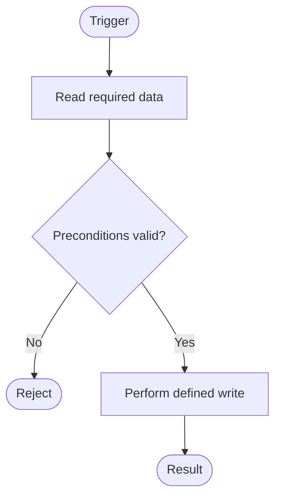
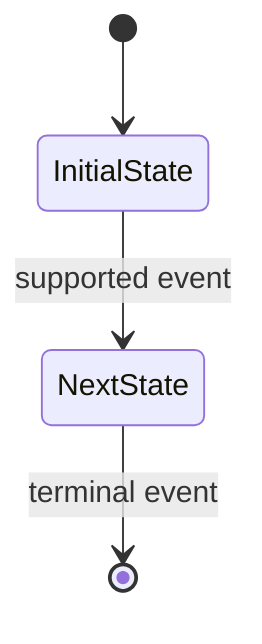

# Data Impact: <Feature Name>

> **Completion:**
>
> - Keep all nine numbered sections in order. Replace prompts with sourced content and remove this note.
> - Use `None — reason` for considered, inapplicable items; use `Unknown — missing evidence and impact` when facts are not established.
> - Preserve project identifiers and source IDs. Define facts once and reference their IDs elsewhere.
> - Write narrative content in the Feature Specification's language. Include the required Mermaid diagrams.

## 1. Overview

### Feature Context

- **Feature:** <name>
- **Slug:** <lowercase-kebab-case>
- **Datastores:** <technology/type, role, and owned structures for each store>
- **Feature Specification:** <path and relevant sections>
- **UI Specification:** <path/sections or None>
- **System Data Model Document:** <relevant paths>
- **Project Conventions / Architecture Docs:** <relevant paths or None found>

### Source Register

> One row per source supporting requirements or design facts. Include path and heading/line/requirement ID where available.

| Source ID | Source Type and Location | Relevant Passage / Requirement | Evidence Status                                    |
| --------- | ------------------------ | ------------------------------ | -------------------------------------------------- |
| SRC-01    | <path and location>      | <faithful summary>             | <Confirmed Fact / Approved Assumption / Inference> |

### Data Requirements and Traceability

> One row per data requirement. List supporting source IDs and its disposition: OP, existing structure, DMC, AP, constraint, state transition, or reason no model change is needed. For UI values, classify as persisted existing, persisted new, derived, or transient.

| Source IDs | Requirement / Rule | Disposition    | Open Issue / Consequence      |
| ---------- | ------------------ | -------------- | ----------------------------- |
| SRC-01     | <requirement>      | <ID or reason> | <None or Unknown with impact> |

### Operations

> One row per distinct action that reads or writes persisted data. Each OP needs a Data Flow subsection and flowchart. Combine actions only when their data and failure behavior are the same.

| Operation ID | Operation Name and Trigger | Source IDs |
| ------------ | -------------------------- | ---------- |
| OP-01        | <action and trigger>       | SRC-01     |

### Assumptions and Unknowns

> Record user-approved assumptions and unknowns that affect design. Do not present assumptions as confirmed facts. Use `None — reason` if none remain.

| Item   | Status                          | Basis / Missing Evidence    | Impact / Follow-up          |
| ------ | ------------------------------- | --------------------------- | --------------------------- |
| <item> | <Approved Assumption / Unknown> | <basis or missing evidence> | <affected decision or None> |

## 2. Data Model Changes

> If no current or previously synchronized DMC remains relevant, write `None`. Otherwise include one summary row and one detail block per DMC. Exclude rejected, unapproved, and unsynchronized proposals.

| DMC ID | Change Kind                                    | Target         | Classification        | Dependencies      |
| ------ | ---------------------------------------------- | -------------- | --------------------- | ----------------- |
| DMC-01 | <Add entity / Add field / Modify field / etc.> | <exact target> | <Additive / Breaking> | <DMC IDs or None> |

**Change kinds:**

- **Entity:** Add, Modify, Remove.
- **Field:** Add, Modify, Remove, Rename.
- **Relationship:** Add, Modify, Remove.
- **Index:** Add, Modify, Remove.
- **Constraint:** Add, Modify, Remove.
- **Other:** Modify key design, Configure retention/TTL, Other structural change.

> Use key-design change kinds for primary/partition/sort keys and index change kinds for secondary indexes. Use entity-level changes only when no more specific kind applies.

### DMC-01 — <Short Title>

**Sources:** <SRC-01, SRC-02>

**Why:** <Unmet requirement and why existing structures/access paths do not satisfy it. Name AP IDs for key/index changes.>

**Classification Rationale:** <Compatibility with existing data, old/new application versions, consumers, and datastore behavior.>

**Before Change:**

- **Model Location:** <file and model location>
- **Existing Shape and Semantics:** <current target or parent structure; state explicitly when a new target does not exist>
- **Existing Index Definition:** <current definition for Modify/Remove Index; otherwise None>
- **Existing Constraint Definition:** <current rule for Modify/Remove Constraint; otherwise None>

**After Change:**

- **Entity / Purpose:** <entity and responsibility, or None>
- **Fields:** <one row per added/changed field; otherwise None>

  | Field Name / Path | Data Type / Representation | Presence                    | Nullable                        | Default / Generation | Constraints / Validation | Description |
  | ----------------- | -------------------------- | --------------------------- | ------------------------------- | -------------------- | ------------------------ | ----------- |
  | <field>           | <type and storage shape>   | <Required / Optional / N/A> | <Nullable / Not Nullable / N/A> | <value or rule>      | <rules or None>          | <meaning>   |

  Keep field presence (missing vs present) separate from nullability (null vs non-null). Use N/A only when the store has no such distinction.

- **Keys and Relationships:** <keys, cardinality, optionality, FK behavior, or embedded/reference semantics; otherwise None>
- **Indexes and Access Paths:** <for added/modified indexes, define them below and name supporting AP IDs; for removal, use None here and describe it under Before Change and Rename / Removal Mapping>

  | Index / Access Path | Kind   | Ordered Keys | Unique           | Predicate / Projection / Options | Supporting AP IDs |
  | ------------------- | ------ | ------------ | ---------------- | -------------------------------- | ----------------- |
  | <name>              | <kind> | <keys>       | <Yes / No / N/A> | <options or None>                | <AP-01>           |

- **Constraints and Validation:** <define added/modified rules below; otherwise None>

  | Constraint / Validator | Rule         | Scope and Enforcement                  |
  | ---------------------- | ------------ | -------------------------------------- |
  | <name>                 | <exact rule> | <database/store, application, or both> |

- **Retention / TTL:** <field/key, period/rule, expiry semantics, exclusions/holds, linked data; otherwise None>
- **Rename / Removal Mapping:** <old → new or what is removed and why; otherwise None>
- **Other Structural Definition:** <exact store-specific change; otherwise None>

**Migration and Rollout:**

- **Existing Data / Backfill:** <whether needed; deterministic rule and invalid-data handling, or why not needed>
- **Rollout Strategy:** <Expand → Migrate → Contract when suitable; otherwise explain why and give ordered alternative stages>
- **Version Compatibility:** <old/new app and model versions supported at each stage>
- **Rollback and Recovery:** <safe rollback point, recovery/compensation, irreversible point>
- **Operational Risk:** <locks, build duration, write/storage cost, throttling, consistency window, or Unknown>

**Affected Consumers:** <known consumers and evidence locations; if none found, state search scope>

> Keep Gate 1 alternatives out of the DMC block. Record selected/rejected alternatives in Section 9.

## 3. Entity Access Map

> One row per operation and persisted structure. Qualify the datastore when names are ambiguous. `Delete` means physical removal; soft-delete is normally `Update`.

| Operation ID | Store / Entity / Structure | Access Actions                               |
| ------------ | -------------------------- | -------------------------------------------- |
| OP-01        | <store / entity>           | <Create, Read, Update, Delete as applicable> |

## 4. Data Flow

> One subsection and one Mermaid flowchart per OP. Prose is authoritative; the diagram summarizes the flow. Show meaningful failure paths and external/asynchronous effects. Do not imply unsupported atomicity.

### OP-01 — <Operation Name>

- **Trigger and Preconditions:** <trigger, actor/context, preconditions, source IDs>
- **Reads:** <entities and fields/keys; consistency where material>
- **Validation and Branches:** <checks, guards, branch and failure behavior>
- **Writes and Side Effects:** <fields created/changed/deleted; events or downstream effects>
- **Transaction and Consistency Boundary:** <atomic scope, non-atomic work, consistency window, compensation>
- **Concurrency, Idempotency, and Retry:** <conflict control, deduplication, retryable/terminal failures>
- **Flow Diagram:**

## 5. Access Patterns & Indexing

> One row per material read/write path affecting keys, indexes, uniqueness, lookup, ordering, pagination, or scale. Link it to OPs and its supporting key/index or explain why none is needed. Do not claim runtime performance without evidence.

| AP ID | Operation IDs | Store / Entity | Kind                           | Filter / Lookup / Write Key | Sort / Pagination / Result | Expected Frequency / Scale | Supporting Key or Index          | Assessment / Reason      |
| ----- | ------------- | -------------- | ------------------------------ | --------------------------- | -------------------------- | -------------------------- | -------------------------------- | ------------------------ |
| AP-01 | OP-01         | <store/entity> | <read/write/lookup/uniqueness> | <predicate or key>          | <order/page/result>        | <estimate or Unknown>      | <key/index/DMC/None with reason> | <suitability/limitation> |

## 6. Business Constraints

> One row per requirement-driven invariant. Exclude lifecycle transitions and do not repeat the full DMC definition. State source, enforcement, and observable violation behavior. Use `None — reason` if none apply.

| Constraint / Rule    | Source IDs | Entity / Field Path | Enforcement                            | Behavior on Violation                 |
| -------------------- | ---------- | ------------------- | -------------------------------------- | ------------------------------------- |
| <rule and condition> | <SRC-01>   | <entity.field>      | <database/store, application, or both> | <reject/error/no change/compensation> |

## 7. State Transition Model

> Include each persisted lifecycle created/changed by the feature or used to validate an operation. Model only sourced states and transitions. If no relevant lifecycle exists, write `None`.

### <Entity>.<State Field>

- **Source IDs:** <SRC-01>
- **Current State Storage and Validation:** <field/path, allowed-value enforcement, DMC if changed>
- **Invalid Transition Handling:** <reject/error/no unintended data change; enforcement point>
- **Concurrency Control:** <conditional write/version check/transaction/lock supported by the store>
- **Transition History:** <history structure or DMC; otherwise None with reason>
- **State Definitions:**

  | State   | Meaning   | Initial?   | Terminal?  | Source IDs |
  | ------- | --------- | ---------- | ---------- | ---------- |
  | <state> | <meaning> | <Yes / No> | <Yes / No> | <SRC-01>   |

- **Allowed Transitions:**

  > If none are defined or changed by this feature, write `None — reason` instead of an empty table.

  | From State | Event / Operation | Guard / Precondition | To State | Data Effects     | Actor   | Source IDs |
  | ---------- | ----------------- | -------------------- | -------- | ---------------- | ------- | ---------- |
  | <state>    | <event or OP-01>  | <condition or None>  | <state>  | <fields/effects> | <actor> | <SRC-01>   |

- **State Diagram:**

> The table is canonical. The diagram must show only the same sourced states and transitions. With no in-scope transition, show sourced states without inventing edges.

## 8. Cross-cutting Concerns

> Summarize design effects; reference other sections instead of repeating them. Use `None — reason` or `Unknown — missing evidence and impact` as appropriate.

### Volume & Growth

<Volume, size, growth, frequency, hot-key/cardinality risks, and impact on partitioning/indexes/retention.>

### Sensitive Data & Access

<Classification, authorization, tenant/owner isolation, encryption/masking, and compliance requirements.>

### Retention & Deletion

<Retention basis/period, hard/soft delete, archival, legal hold, cascade, TTL semantics, linked/duplicated data.>

### Consistency & Duplication

<Source of truth, consistency model, denormalization/embedded copies, conflict handling, repair, freshness, cross-store consistency.>

### Auditing, Idempotency & Replay

<Audit/history, actor/time/correlation metadata, duplicate requests/events, retries, replay, idempotency keys.>

### Operational Reliability

<Failure modes, backup/recovery, rollback, index/backfill impact, throttling/locking/availability, material monitoring signals.>

## 9. Design Decisions

> Record material choices and alternatives, especially denormalization, keys/indexes, consistency/history, integrity, retention, and exceptions. Link relevant IDs. Do not repeat a DMC's Why. Use `None — reason` if no material alternatives existed.

| Decision / Topic | Related IDs      | Selected Approach | Rationale and Trade-offs       | Alternatives Considered / Rejected | Status / Basis                                                      |
| ---------------- | ---------------- | ----------------- | ------------------------------ | ---------------------------------- | ------------------------------------------------------------------- |
| <decision>       | <SRC/AP/DMC IDs> | <choice>          | <benefit, cost, residual risk> | <alternative and reason>           | <recommended/user-confirmed/project convention/approved assumption> |
