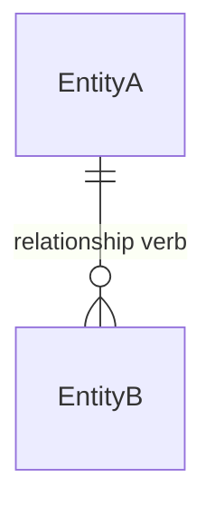

# Database Design: <System or Feature Name>

<!-- Authoring contract: Replace every <...> placeholder and remove every authoring comment. Use confirmed requirements and project conventions. Mark non-blocking unknowns 'Not specified' only in the affected field. Omit any section, subsection, table, or row that has no applicable content. Repeat the Collection block once per collection and the row pattern once per item. -->

## Design Summary

| Property            | Value                                                             |
| ------------------- | ----------------------------------------------------------------- |
| System / Feature    | <System or feature name>                                          |
| Scope               | <In-scope and out-of-scope items>                                 |
| DBMS / Version      | <Document DBMS name and supported target version>                 |
| Source Requirements | <Requirement IDs or source document paths>                        |
| Required Features   | <Only non-default features required by this design, with version> |

### Design Intent

<Briefly state the data problem and the key modeling decisions>

## Access Patterns

<!-- Repeat one row per materially distinct operation. Keep only fields that affect document shape, query, index, or atomicity decisions. -->

| ID    | Operation          | Mode         | Collections                   | Predicate / Order                             | Result / Consistency / Atomicity                                     |
| ----- | ------------------ | ------------ | ----------------------------- | --------------------------------------------- | -------------------------------------------------------------------- |
| AP-01 | <Domain operation> | <Read/Write> | <Collections read or changed> | <Filters, tenant scope, sort, and pagination> | <Result shape and freshness; for writes, the required atomic effect> |

## Business Rules

<!-- Repeat one row per confirmed invariant. Identify the authoritative mechanism; distinguish database validation from application and transaction enforcement. -->

| ID    | Rule                         | Enforcement                                                                                  | Source                       |
| ----- | ---------------------------- | -------------------------------------------------------------------------------------------- | ---------------------------- |
| BR-01 | <Precise business invariant> | <Validator/unique index/conditional write/transaction/application rule and failure behavior> | <Requirement or decision ID> |

## Entity Model

<!-- Show logical entities and cardinalities only. Do not imply that MongoDB references are foreign keys. -->



### Entity Definitions

| Entity        | Meaning          | Logical Identifier          | Key Scope / Lifecycle                      |
| ------------- | ---------------- | --------------------------- | ------------------------------------------ |
| <Entity name> | <Domain meaning> | <Stable logical identifier> | <Business-key scope and lifecycle summary> |

## Relationships

<!-- Repeat one row per relationship. State the chosen embed/reference strategy, ownership, and growth/integrity implications. -->

| Relationship         | Cardinality / Optionality                           | Mapping                                              | Growth / Integrity                                                  |
| -------------------- | --------------------------------------------------- | ---------------------------------------------------- | ------------------------------------------------------------------- |
| <EntityA to EntityB> | <A-to-B and B-to-A cardinality; mandatory/optional> | <Embed at parent.field / reference collection.field> | <Bounded growth, independent lifecycle, and orphan/integrity owner> |

## Collections

<!-- REPEAT BLOCK: Copy the complete collection block below once for every collection. Replace its heading with the exact database and collection name. Keep each collection's fields, example document, and validation together. -->

### <database.collection_name>

<Purpose, represented aggregate, _id type/generation, expected document size, and embedded-array growth bounds; keep ordinary documents below 16 MiB and time-series measurements below 4 MB>

| Field Path   | BSON Type   | Required | Rule / Meaning                                       |
| ------------ | ----------- | -------- | ---------------------------------------------------- |
| <field.path> | <BSON type> | <Yes/No> | <Allowed values, bounds, business meaning, or BR-nn> |

#### Example Document

<!-- Provide one realistic, internally consistent document using representative BSON values. It must match the field definitions and validation rules. Use Extended JSON or clearly label shell constructors such as ObjectId() and ISODate(). -->

```javascript
{
  _id: ObjectId("<24-hex-character-example-id>"),
  <fieldName>: "<representative value>"
}
```

#### Validation

<Validator summary; validationLevel strict/moderate/off/constraint; validationAction error/errorAndLog/warn; same-document rules, collection-type limitations, and legacy-data migration plan when applicable>

## Indexes

<!-- Include Indexes only for justified query, uniqueness, or lifecycle requirements. -->

| Index        | Collection        | Keys / Type                                                                  | Options                                      | Supports         | Reason                                                      |
| ------------ | ----------------- | ---------------------------------------------------------------------------- | -------------------------------------------- | ---------------- | ----------------------------------------------------------- |
| <index_name> | <collection_name> | <fieldA: 1, fieldB: -1; or a text/2dsphere/hashed/wildcard index definition> | <Unique/Partial/Sparse/TTL/Collation/Hidden> | <AP-nn or BR-nn> | <Query shape, uniqueness scope, or lifecycle justification> |

## Design Patterns

<!-- Include Design Patterns only when a named pattern solves a documented access, growth, consistency, or lifecycle problem. -->

| Pattern                                                                                      | Collection / Field | Source of Truth        | Maintenance / Bound                                                          | Supports         |
| -------------------------------------------------------------------------------------------- | ------------------ | ---------------------- | ---------------------------------------------------------------------------- | ---------------- |
| <Computed/Bucket/Subset/Extended Reference/Attribute/Polymorphic/Outlier/Tree/Archive/other> | <Pattern location> | <Authoritative source> | <Update method, staleness, growth bound, and repair/reconciliation approach> | <AP-nn or BR-nn> |

## Transactions and Concurrency

<!-- Include Transactions and Concurrency only when writes exist. Prefer single-document atomicity. -->

| Operation            | Invariant / Atomic Boundary                            | Read / Write Concern                        | Concurrency Control                                                                  | Retry / Failure                                       |
| -------------------- | ------------------------------------------------------ | ------------------------------------------- | ------------------------------------------------------------------------------------ | ----------------------------------------------------- |
| <Operation or AP-nn> | <BR-nn and single-document or multi-document boundary> | <Required readConcern/writeConcern and why> | <Conditional update/version check/unique index/shared conflict document/transaction> | <Retry and idempotency rule; client-visible conflict> |

## Security and Data Protection

<!-- Include only applicable role, sensitive-data, and application-authorization details. If all are inapplicable, omit the entire section. Omit every empty subsection. -->

### Roles and Privileges

| Role        | Principal          | Allowed Scope / Actions                            | Enforcement Boundary                         |
| ----------- | ------------------ | -------------------------------------------------- | -------------------------------------------- |
| <Role name> | <Service or actor> | <Database/collection and read/write/admin actions> | <MongoDB RBAC and application authorization> |

### Sensitive Data

| Collection.Field        | Classification                   | Protection                                     | Query Impact             |
| ----------------------- | -------------------------------- | ---------------------------------------------- | ------------------------ |
| <collection.field.path> | <Project-defined classification> | <Minimize/encrypt/tokenize/mask and key owner> | <Query/index limitation> |

### Application Authorization

<Trusted identity source and object-/tenant-level authorization rules; database RBAC does not automatically filter documents by tenant>

## Data Lifecycle

<!-- Include this section only when at least one collection has applicable lifecycle decisions. -->

| Collection        | History / Audit                                 | Delete / Restore                                       | Retention / Archive                                                                       |
| ----------------- | ----------------------------------------------- | ------------------------------------------------------ | ----------------------------------------------------------------------------------------- |
| <collection_name> | <Required fields/events and trusted maintainer> | <Hard delete/soft delete/archive and restore behavior> | <Confirmed period and TTL/job/archive mechanism; account for TTL's asynchronous deletion> |

## Tenant Isolation

<!-- Include only for multi-tenant systems. -->

| Decision                 | Design                                                               |
| ------------------------ | -------------------------------------------------------------------- |
| Isolation Model          | <Shared collections/database per tenant/dedicated deployment/hybrid> |
| Trusted Tenant Context   | <Authenticated source and BSON type>                                 |
| Tenant Keys / References | <Tenant-scoped unique indexes and reference checks>                  |
| Enforcement              | <Application authorization and physical isolation boundary>          |

## Collection Options

<!-- Include only for non-default collection semantics, such as time-series. For time-series, capture the 4 MB document cap, absent schema validation/default _id index/unique indexes, unsupported transactional writes, restricted updates/indexes, and any sharding limitations that affect the design. -->

| Collection        | Type / Options                                                             | Validation Limitation                                          | Transaction / Index Limitation                                           | Retention                                          |
| ----------------- | -------------------------------------------------------------------------- | -------------------------------------------------------------- | ------------------------------------------------------------------------ | -------------------------------------------------- |
| <collection_name> | <Time-series: timeField, metaField, granularity; or other special options> | <Applicable validation support or application validation path> | <Only relevant restrictions for this collection type and target version> | <expireAfterSeconds or confirmed lifecycle policy> |

## Sharding

<!-- Include only when the approved target topology is sharded. Add one concise rationale above the table stating why sharding is needed and which viable shard-key alternatives were rejected. -->

| Collection        | Shard Key / Strategy                                | Query Targeting / Distribution                              | Unique-Key Compatibility                                            |
| ----------------- | --------------------------------------------------- | ----------------------------------------------------------- | ------------------------------------------------------------------- |
| <collection_name> | <Shard key fields/order and ranged/hashed strategy> | <AP-nn targeting, cardinality, frequency, and hotspot risk> | <Unique-index prefix compatibility and _id uniqueness implications> |

## Views

<!-- Include only when a stable read interface or derived read model is justified. -->

| Name                      | Kind                                     | Purpose / Sources                                     | Authorization       | Freshness / Refresh                                | Target Indexes                                               |
| ------------------------- | ---------------------------------------- | ----------------------------------------------------- | ------------------- | -------------------------------------------------- | ------------------------------------------------------------ |
| <view_or_projection_name> | <View/On-demand materialized collection> | <Consumers, source collections, and pipeline summary> | <Security boundary> | <Refresh trigger, maximum staleness, and recovery> | <Indexes on a materialized target collection, if applicable> |
