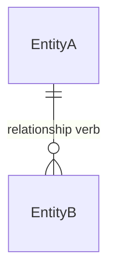

# Database Design: <System or Feature Name>

<!-- Authoring contract: Replace every <...> placeholder and remove every authoring comment. Use confirmed requirements and project conventions. Mark non-blocking unknowns 'Not specified' only in the affected field. Omit any section, subsection, table, or row that has no applicable content. Repeat the Table block once per table and the row pattern once per item. -->

## Design Summary

| Property                           | Value                                                       |
| ---------------------------------- | ----------------------------------------------------------- |
| System / Feature                   | <System or feature name>                                    |
| Scope                              | <In-scope and out-of-scope items>                           |
| DBMS / Version                     | <DBMS name and supported target version>                    |
| Source Requirements                | <Requirement IDs or source document paths>                  |
| Required Extensions / Capabilities | <Extensions/features required by this design, with version> |

### Design Intent

<Briefly state the data problem and the key modeling decisions>

## Access Patterns

<!-- Repeat one row per materially distinct operation. Keep only fields that affect physical design. -->

| ID    | Operation          | Mode         | Tables                   | Predicate / Order                             | Result / Consistency / Atomicity                                     |
| ----- | ------------------ | ------------ | ------------------------ | --------------------------------------------- | -------------------------------------------------------------------- |
| AP-01 | <Domain operation> | <Read/Write> | <Tables read or changed> | <Filters, tenant scope, sort, and pagination> | <Result shape and freshness; for writes, the required atomic effect> |

## Business Rules

<!-- Repeat one row per confirmed invariant. Each rule needs one authoritative enforcement mechanism; mention additional defense-in-depth only when its responsibility is distinct. -->

| ID    | Rule                         | Enforcement                                                    | Source                       |
| ----- | ---------------------------- | -------------------------------------------------------------- | ---------------------------- |
| BR-01 | <Precise business invariant> | <Constraint/transaction/application rule and failure behavior> | <Requirement or decision ID> |

## Entity Model

<!-- Show logical entities and cardinalities only. Use Mermaid crow's-foot markers: o| zero-or-one, || exactly-one, o{ zero-or-many, |{ one-or-many. Keep physical details in later sections. -->

### Entity Definitions

<!-- Repeat one row per entity. -->

| Entity        | Meaning          | Identifier          | Key Scope / Lifecycle                      |
| ------------- | ---------------- | ------------------- | ------------------------------------------ |
| <Entity name> | <Domain meaning> | <Stable identifier> | <Business-key scope and lifecycle summary> |

## Relationships

<!-- Repeat one row per relationship. Include optionality at both ends and physical FK placement. -->

| Relationship         | Cardinality / Optionality                           | Ownership                                  | Relational Mapping / Delete Rule                                   |
| -------------------- | --------------------------------------------------- | ------------------------------------------ | ------------------------------------------------------------------ |
| <EntityA to EntityB> | <A-to-B and B-to-A cardinality; mandatory/optional> | <Owned/dependent or independent lifecycle> | <FK location, uniqueness, and RESTRICT/NO ACTION/CASCADE/SET NULL> |

## Tables

<!-- REPEAT BLOCK: Copy the complete table block below once for every table. Replace its heading with the exact qualified table name. Never place multiple tables in one column-definition table. -->

### <schema.table_name>

<One-sentence purpose and source logical entity>

| Column        | Type                    | Null            | Default / Generation              | Constraint / Rule                       | Meaning            |
| ------------- | ----------------------- | --------------- | --------------------------------- | --------------------------------------- | ------------------ |
| <column_name> | <Target-DBMS data type> | <NULL/NOT NULL> | <Expression/identity/generated/—> | <PK/UK/FK/CHECK or BR-nn; omit if none> | <Business meaning> |

#### Table-Level Constraints

<!-- Add this table only when the table has composite, exclusion, temporal, deferrable, or other table-level constraints that are not clear from the column rows. Repeat one row per constraint. -->

| Constraint        | Definition                                           | References                         | Rule    |
| ----------------- | ---------------------------------------------------- | ---------------------------------- | ------- |
| <constraint_name> | <Constraint type and constrained columns/expression> | <Referenced table/columns, if any> | <BR-nn> |

## Indexes

<!-- Include this section only when at least one additional index needs a design decision. Repeat one row per justified index. Do not list indexes automatically created to enforce a declared PK/UNIQUE constraint unless their physical definition needs explanation. -->

| Index        | Table          | Keys / Options                                                             | Supports         | Reason                                                          |
| ------------ | -------------- | -------------------------------------------------------------------------- | ---------------- | --------------------------------------------------------------- |
| <index_name> | <schema.table> | <Ordered keys/direction, method, predicate, INCLUDE/opclass when relevant> | <AP-nn or BR-nn> | <Query, uniqueness, FK-maintenance, or lifecycle justification> |

## Normalization

<!-- Always include a concise statement. Name relevant functional dependencies when claiming a normal form beyond an informal assessment. -->

<Normal-form assessment and material functional dependencies; identify any deliberate exception>

## Denormalization

<!-- Include Denormalization only when mutable duplicated/derived values are stored beyond immutable domain snapshots. -->

| Redundant Data              | Source of Truth        | Maintenance / Consistency                           | Supports |
| --------------------------- | ---------------------- | --------------------------------------------------- | -------- |
| <schema.table/table.column> | <Authoritative source> | <Same transaction/event/job and accepted staleness> | <AP-nn>  |

## Design Patterns

<!-- Include Design Patterns only when a specialized pattern is actually used. -->

| Pattern                                               | Tables / Entities          | Invariant / Trade-Off                   | Supports         |
| ----------------------------------------------------- | -------------------------- | --------------------------------------- | ---------------- |
| <Subtype/temporal/ordered-child/semi-structured/etc.> | <Affected tables/entities> | <Why selected and required constraints> | <AP-nn or BR-nn> |

## Transactions and Concurrency

<!-- Include Transactions and Concurrency only when writes exist. One row per operation or group sharing the same invariant and transaction boundary. -->

| Operation            | Invariant / Atomic Boundary                  | Isolation                          | Concurrency Control                                           | Retry / Failure                                       |
| -------------------- | -------------------------------------------- | ---------------------------------- | ------------------------------------------------------------- | ----------------------------------------------------- |
| <Operation or AP-nn> | <BR-nn and work that must commit atomically> | <Required isolation level and why> | <Constraint/conditional update/lock/serializable transaction> | <Retry and idempotency rule; client-visible conflict> |

## Security and Data Protection

<!-- Include only applicable role, sensitive-data, and row-security details. If all are inapplicable, omit the entire section. Omit every empty subsection. -->

### Roles and Privileges

| Role        | Principal          | Allowed Scope / Operations                              | Enforcement Boundary                            |
| ----------- | ------------------ | ------------------------------------------------------- | ----------------------------------------------- |
| <Role name> | <Service or actor> | <Objects and SELECT/INSERT/UPDATE/DELETE/EXECUTE scope> | <Database grants and application authorization> |

### Sensitive Data

| Table.Column          | Classification                   | Protection                                          | Query Impact             |
| --------------------- | -------------------------------- | --------------------------------------------------- | ------------------------ |
| <schema.table.column> | <Project-defined classification> | <Minimize/hash/encrypt/tokenize/mask and key owner> | <Search/index trade-off> |

### Row-Level Security

<Policy scope, trusted tenant/user context source, runtime-role ownership/BYPASSRLS behavior, and whether the runtime role can change custom context>

## Data Lifecycle

<!-- Include this section only when at least one entity/table has applicable lifecycle decisions. Include only entities/tables with audit, history, deletion, retention, archive, or anonymization requirements. Do not infer periods or legal obligations. -->

| Table          | History / Audit                         | Delete / Restore                                                | Retention / Archive                                              |
| -------------- | --------------------------------------- | --------------------------------------------------------------- | ---------------------------------------------------------------- |
| <schema.table> | <Required fields/events and maintainer> | <Hard delete/soft delete/restrict/archive and restore behavior> | <Confirmed period and purge/archive mechanism, or Not specified> |

## Tenant Isolation

<!-- Include only for multi-tenant systems. -->

| Decision                    | Design                                                                            |
| --------------------------- | --------------------------------------------------------------------------------- |
| Isolation Model             | <Shared tables/schema per tenant/database per tenant/dedicated deployment/hybrid> |
| Trusted Tenant Context      | <Authenticated source and database/application propagation>                       |
| Tenant Keys / Relationships | <Tenant-scoped unique and FK constraints>                                         |
| Enforcement                 | <RLS/application boundary; state owner and bypass behavior>                       |

## Partitioning

<!-- Include only when partitioning is justified by access, lifecycle, or scale evidence. -->

| Table          | Method / Key                        | Benefit / Evidence                                                                                           | Key Constraints                                    |
| -------------- | ----------------------------------- | ------------------------------------------------------------------------------------------------------------ | -------------------------------------------------- |
| <schema.table> | <Range/List/Hash and partition key> | <AP-nn pruning predicates, granularity/maintenance policy, or retention operation; scale/lifecycle evidence> | <Impact on PK/UNIQUE/FK and partition maintenance> |

## Views

<!-- Include only when a stable read interface or derived read model is justified. -->

| Name        | Kind                     | Purpose / Sources                             | Security                                     | Refresh / Freshness / Indexes                              |
| ----------- | ------------------------ | --------------------------------------------- | -------------------------------------------- | ---------------------------------------------------------- |
| <view_name> | <View/Materialized View> | <Consumers, source tables, joins/aggregation> | <Owner/invoker semantics and access control> | <Refresh trigger, maximum staleness, and required indexes> |
