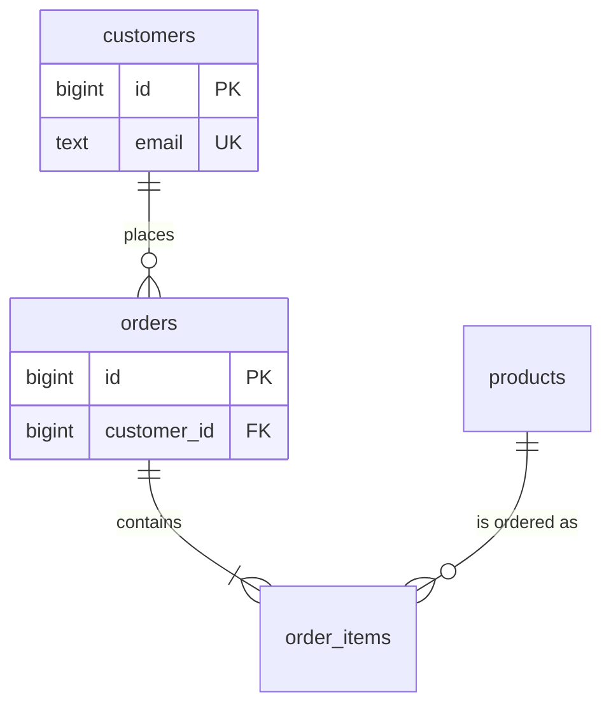

# Conceptual Modeling

Build the logical domain model before translating it into tables or documents. This reference applies to both relational and document-oriented designs.

## Entities and Attributes

- **Entity:** a business concept with identity, lifecycle, or relationships that the system must record (for example, `Customer`, `Order`, or `Subscription`).
- **Attribute:** a fact that describes an entity (for example, `Order.placedAt`). Keep attributes that share the same identity and lifecycle together unless access, sensitivity, or size justifies separation.
- Promote an attribute or repeating value to an entity when it has its own identity/lifecycle, its own attributes, an independent relationship, or an independently managed set of values.
- A derived value is a rule over source facts. Store it only when it represents a separate business fact (such as a price snapshot) or when a justified read model requires it.
- Distinguish current state from event-time facts and valid-time facts. A value captured at purchase time is not automatically the same fact as the current product value.
- Name entities with singular nouns during analysis. Final names follow the paradigm conventions.

## Identification

An identifier should be stable, unique within its scope, non-null, and immutable. Do not use a mutable value (email, display name, phone number) as identity.

- Keep a stable natural key when it is compact, immutable, unique in the actual scope, and useful to the domain.
- Use a surrogate identifier when no suitable natural key exists, when the natural key is mutable, or when a natural/composite key is impractical for references and indexes.
- A composite key is valid when the combination is the natural identity and remains stable. Do not add a surrogate solely because a key has multiple columns.
- When both surrogate identity and a stable business key exist, enforce business-key uniqueness in its proper scope (including tenant or validity scope).
- Define uniqueness scope explicitly: global, per tenant, per parent, per time period, or another domain boundary.
- An opaque ID is not a security control and must not replace authorization checks.

## Relationships

For every relationship, derive and record:

- **Cardinality:** one-to-one (1:1), one-to-many (1:N), or many-to-many (M:N).
- **Optionality:** whether participation is mandatory or optional at each end.
- **Ownership:** whether the child has an independent lifecycle or exists only as part of the owner.
- **Direction and meaning:** express both directions in domain terms.

**Example:** "A customer may place zero or many orders. Each order belongs to exactly one customer."

- Derive rules from requirements and domain semantics, not sample counts or example payloads.
- A many-to-many relationship with attributes or its own lifecycle is an associative entity (for example, `Enrollment` with `grade` and `enrolledAt`).
- A relationship among more than two entities is a distinct association when the combination itself has meaning (for example, a supplier supplies a part to a project).
- A one-to-one relationship is a merge candidate. Keep entities separate only when lifecycle, access pattern, ownership, size, or sensitivity justifies separation.
- Name relationships with a clear verb phrase.

## Dependent Entities

A dependent entity's existence is controlled by an owner, but that does not automatically determine its key or deletion mechanism.

- Record whether the child is meaningful outside the parent and whether it can be moved or reassigned.
- A weak entity may use the owner identifier plus a local discriminator as its identity. An independently addressable dependent may use its own identifier and a mandatory owner reference.
- Choose cascading deletion only when the domain confirms that the child must be deleted with the owner. Otherwise use restriction, archival, reassignment, or another explicit lifecycle rule.

## Subtypes

Use a supertype/subtype model when entities share common attributes or relationships, but each subtype has its own specific attributes or characteristics.

Record both subtype constraints:

- **Disjoint:** an instance belongs to at most one subtype; **Overlapping:** it may belong to multiple subtypes.
- **Total:** every supertype instance belongs to at least one subtype; **Partial:** subtype membership is optional.

Choose the physical mapping in the selected paradigm's reference. Do not create a type hierarchy solely to mirror application classes.

## Recursive Relationships

An entity may relate to itself (for example, an employee reports to an employee, or a category has a parent category).

- **Tree:** each non-root node has at most one parent.
- **Directed Acyclic Graph (DAG):** a node may have several parents, but cycles are forbidden.
- **Graph:** cycles may be meaningful and allowed.
- Record whether roots are allowed, maximum depth if bounded, cycle policy, and common ancestor/descendant access patterns.
- Select an adjacency, path, closure, or reference-array representation only in the paradigm-specific physical design.

## Time Semantics

Distinguish three concepts before selecting types:

- **Instant:** one point on the global timeline; store an unambiguous UTC instant.
- **Calendar Date:** a date without time-of-day or timezone semantics (for example, a birthday or invoice date).
- **Local Schedule:** a local wall-clock time governed by a named timezone and daylight-saving rules. Store the IANA timezone identifier with the schedule where needed.

For periods, define whether endpoints are inclusive/exclusive, whether open-ended periods are allowed, which clock defines validity (valid time vs transaction time), and whether overlaps are permitted.

## ER Diagram Notation

Use Mermaid `erDiagram` with crow's-foot notation for the logical entity model. Keep diagrams readable; split large domains into subject-area diagrams.

| Marker (left) | Marker (right) | Meaning      |
| ------------- | -------------- | ------------ |
| `\|o`         | `o\|`          | Zero or one  |
| `\|\|`        | `\|\|`         | Exactly one  |
| `}o`          | `o{`           | Zero or more |
| `}\|`         | `\|{`          | One or more  |

The marker beside an entity describes how many instances of that entity may relate to one instance of the entity at the opposite end. `--` denotes an identifying relationship; `..` denotes a non-identifying relationship. Use the final logical entity names; do not imply that a document reference is enforced as a database foreign key.

Show key attributes only. Use `PK`, `FK` and `UK` in SQL diagrams; use logical identifiers in document diagrams and describe the reference strategy separately. Put full field definitions in the physical-model section.

**Example:**

**Reading:** a customer places zero or more orders; each order belongs to one customer and contains one or more order items; each order item refers to one product, and a product may appear in many order items.

## Output Mapping

- `Entity Model`: one or more ER diagrams with every entity, relationship, cardinality, and optionality.
- The paradigm-specific relationship section: the physical implementation, ownership, reference or embedding location, and any growth or lifecycle constraints.
