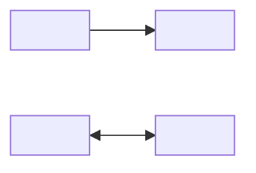
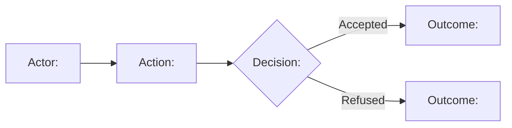

<!--
Domain Model Template — Authoring Guide

Completion Rules
- Replace each <...> instruction with confirmed project content. Remove this
  guide, other authoring comments, and unused illustrative rows or diagrams.
- Complete only the agreed scope using approved requirements and authoritative
  human decisions. Resolve material ambiguities before writing the final model.
  Do not include open questions, hypotheses, approval logs, validation status,
  or test reports. Do not invent DDD elements to populate optional sections.
- Use the business's language consistently across context names, glossary,
  rules, behaviors, messages, and diagrams. Use stable source/rule IDs where
  useful; cite authoritative evidence for significant rules and distinctions.
- For a required category confirmed to be empty, use 'None'. Never remove or
  rename a required section simply because its content is empty.

Section Guidance
1. Domain Overview: business purpose, agreed scope, exclusions, and material
   actors or external systems if they clarify responsibilities.
2. Subdomains: business capabilities and justified Core, Supporting, or Generic
   classification. Do not model services or software modules as subdomains.
3. Context Map: list every in-scope bounded context, including isolated ones;
   include only supported model relationships. Model influence is not message
   direction; external collaborators need not be locally modeled contexts.
4.N. Bounded Context: clarify ownership and model boundary, context-specific
   language, confirmed rules, and business actions/outcomes independently of
   optional tactical patterns. Optional patterns (flows, aggregates, lifecycles,
   policies, domain services) appear only when they explain real business
   behavior or constraints.
-->

# Domain Model: <Domain Name>

## 1. Domain Overview

- **Purpose:** <State the business problem and desired outcome in one or two sentences>
- **Scope:** <Name the included business capabilities and model boundaries>
- **Exclusions:** <State agreed out-of-scope responsibilities, or None>

### Actors and External Systems

<!-- Optional. Include relevant business actors and external collaborators only. -->

| Collaborator                    | Kind                       | Business Role                           |
| ------------------------------- | -------------------------- | --------------------------------------- |
| <Actor or external system name> | <Actor or External System> | <Role in an in-scope business scenario> |

## 2. Subdomains

| Subdomain                   | Type                      | Business Capability | Rationale          |
| --------------------------- | ------------------------- | ------------------- | ------------------ |
| <Name a business subdomain> | <Core/Supporting/Generic> | <Business outcome>  | <Strategic reason> |

## 3. Context Map

### Context Inventory

| Bounded Context            | Business Responsibility                        | Subdomains Covered                     |
| -------------------------- | ---------------------------------------------- | -------------------------------------- |
| <Name the bounded context> | <Primary owned business decisions or outcomes> | <Subdomains or relevant parts covered> |

### Relationships

<!-- Record only material, agreed relationships; write 'None' if there are none.
     Model influence describes upstream/downstream constraints, not message flow.
     Patterns may be combined when they describe different aspects. -->

| Parties                          | Model Influence                   | Relationship Patterns | Business Dependency          |
| -------------------------------- | --------------------------------- | --------------------- | ---------------------------- |
| <Context pair or external model> | <Upstream → Downstream or mutual> | <Patterns and roles>  | <Dependency and translation> |

<!-- Optional diagram. Use actual context names and dependencies; omit when the
     table alone is clearer or when there are no supported relationships. -->

## 4. Bounded Contexts

<!-- Repeat Section 4.N for every context in Context Inventory. -->

### 4.1 <Name the bounded context from Context Inventory>

#### Purpose and Boundaries

- **Responsibility:** <Summarize the business decisions and outcomes owned by this context>
- **Boundary:** <Explain where its model applies, important ownership distinctions, and any material subdomain split or overlap>

#### Ubiquitous Language

| Term                                      | Definition                            | Notes                                                             |
| ----------------------------------------- | ------------------------------------- | ----------------------------------------------------------------- |
| <Name the context-specific business term> | <Define its precise business meaning> | <State relevant aliases, distinctions, or clarifications, if any> |

#### Business Rules

| ID                     | Business Rule                 | Source                       |
| ---------------------- | ----------------------------- | ---------------------------- |
| <Rule ID, e.g., BR-01> | <Confirmed rule or exception> | <Requirement or decision ID> |

#### Business Behavior

<!-- Record essential intentions, triggers, decisions, and outcomes even when no
     Aggregate is modeled. Name an established Domain Event only when meaningful;
     a successful outcome or refusal is not automatically an event. -->

| Action or Trigger   | Decision Owner   | Business Outcome                     | Rules              |
| ------------------- | ---------------- | ------------------------------------ | ------------------ |
| <Action or trigger> | <Decision owner> | <Result, refusal, event if relevant> | <Rule IDs or None> |

#### Business Messages

<!-- Optional. Record only agreed exchanges with other bounded contexts or
     external systems. Direction is relative to this context. In Message, include
     its business kind (Command, Query, Event Notification, or Result/Reply) and
     name. Match the two sides for messages between in-scope contexts. Shared
     Kernel and direct user action do not themselves imply cross-context messages. -->

| Direction             | Collaborator                               | Message                 | Business Meaning                         |
| --------------------- | ------------------------------------------ | ----------------------- | ---------------------------------------- |
| <Inbound or Outbound> | <Other bounded context or external system> | <Message kind and name> | <Purpose and meaningful result or reply> |

#### Business Flows

<!-- Optional. Replace with the actual process and its relevant branches; a
     business outcome is not automatically a Domain Event. Remove when unnecessary. -->

#### Aggregates

<!-- Optional. Repeat only for actual Aggregate consistency boundaries. Keep
     action outcomes in Business Behavior, not duplicated in every Aggregate. -->

**<Name the Aggregate using the domain concept>**

- **Root:** <Root Entity and business identity>
- **Consistency Boundary:** <State the hard rules that must hold together>
- **Internal Concepts:** <Relevant Entities and Value Objects, or None>
- **Invariants:** <Invariant IDs, precise guarantees, and supporting rule IDs>
- **References:** <Other Aggregates referenced by identity, or None>

#### Lifecycles

<!-- Optional. Show only business states restricting allowed actions. -->

#### Policies

<!-- Optional. Include only evidenced business reactions. -->

| Trigger                        | Condition               | Business Reaction            | Owner               |
| ------------------------------ | ----------------------- | ---------------------------- | ------------------- |
| <Fact, condition, or deadline> | <When the rule applies> | <Required business reaction> | <Responsible owner> |

#### Domain Services

<!-- Optional. Do not use for application orchestration or technical helpers. -->

| Domain Service         | Business Operation               | Rules and Inputs               |
| ---------------------- | -------------------------------- | ------------------------------ |
| <Named domain service> | <Domain decision or calculation> | <Business inputs and rule IDs> |
