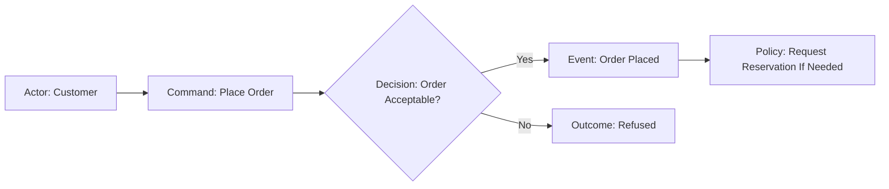

# Event Discovery

Use when understanding business processes, meaningful occurrences, decision paths, or candidate boundaries. When analyzing documents without domain experts in a workshop, describe the result as **EventStorming-inspired discovery**, not as a completed collaborative EventStorming session.

## Choose a Discovery Level

| Level                | Primary Goal                                                              | Useful Outputs                                                         |
| -------------------- | ------------------------------------------------------------------------- | ---------------------------------------------------------------------- |
| **Big Picture**      | Understand important business changes and handoffs across a larger domain | Timeline, pivotal events, actors, hotspots, possible boundaries        |
| **Process Modeling** | Understand what causes decisions and what information is needed           | Commands/actions, policies, information, alternatives, outcomes        |
| **Software Design**  | Explore where business decisions and consistency belong                   | Candidate aggregates, constraints, responsibilities, state transitions |

These are different lenses, **not mandatory consecutive stages**. Choose the level that answers the request. A static terminology task may not need events at all.

## Distinguish the Elements

| Element                      | Definition                                                               | Illustration                                       |
| ---------------------------- | ------------------------------------------------------------------------ | -------------------------------------------------- |
| **Domain Event**             | Business-significant occurrence already established as a fact            | `OrderPlaced`                                      |
| **Command / Action**         | Intention to perform a business action; may be refused                   | `PlaceOrder`                                       |
| **Actor / External Trigger** | Person, role, external party, or time condition that initiates action    | `Customer`; `PaymentProvider`                      |
| **Policy**                   | Conditional reaction to an occurrence or recognized condition            | On order acceptance, request fulfillment if needed |
| **Information / Query**      | Facts needed to make a decision, or a request for them                   | `AvailableStock`                                   |
| **Hotspot**                  | Unresolved meaning, conflicting rule, owner, timing, or process question | Is credit reserved before confirmation?            |

A state predicate (`OrderIsOverdue`) describes a condition; an event (`OrderBecameOverdue`) describes a transition that the business **may** recognize. A technical operation (`RecordSaved`) is not automatically a domain event. A refusal is not automatically an event, either: `PaymentDeclined` is a relevant domain fact only if the business observes or records that outcome.

**Time:** A deadline or elapsed period may prompt a decision or transition; neither requires inventing an event called `TimeElapsed`. Clarify whether expiration is an explicit business occurrence, a derived status, or an action scheduled after a condition is detected.

## Discover the Big Picture

1. Extract meaningful **completed business outcomes** from each source scenario, using the words domain experts employ. Preserve references to requirements or evidence.
2. Place them on a rough timeline; keep alternative, parallel, and optional branches instead of enforcing one straight success path.
3. Identify actors, collaborators, key information handoffs, and pivotal events where business responsibility or meaning changes substantially.
4. Mark hotspots where definitions, decisions, exceptions, or timings conflict or are unknown. Prioritize by their business impact.
5. Propose capability or context boundaries only as **hypotheses**. Validate them with `strategic-design.md`, language, and real scenarios.
6. Ask the responsible experts to resolve significant hotspots as they appear. Keep unanswered items in working discovery notes only; do not export them into the final domain model or invent an outcome to eliminate them.

**Illustrative event timeline:**

```text
A customer requests a reservation.
  → ReservationRequested     [only if requests are recorded as business facts]
  → StockReserved            [success branch]
  → ReservationRefused       [only if recorded and meaningful]
  → ReservationExpired       [only if expiry is an observed business occurrence]
Hotspot: Who decides when a pending reservation stops reserving stock?
```

The example is a modeling exercise, not a universal reservation policy. If the initial request is not an established event, represent it as a **command/action** rather than `ReservationRequested`.

## Model a Business Process

For each material scenario, record:

1. **Trigger:** Actor, external fact, recognized event, or time condition; distinguish what has happened from what someone wants to do.
2. **Intended action:** Command or business activity, its responsible context, and preconditions. Allow refusal or deferral where supported.
3. **Required information:** Facts needed to decide, who owns their meaning, and whether freshness matters. A query or read model is not automatically a domain service.
4. **Decision:** Relevant business rule, invariant, or policy and the authority responsible for its outcome.
5. **Outcome:** State/decision result, meaningful event(s) where warranted, or refusal. **Do not require an event for every command or transition.**
6. **Reaction:** What happens afterward, under which condition, by which actor or context. A policy can be manual, delayed, or automated.
7. **Cross-boundary exchange:** Distinguish the local event from any published business notification; consult `context-mapping.md` when another context's model is involved.

**Example:** `OrderPlaced` might lead to the policy "if fulfillment is necessary, request stock reservation". Whether that reaction is automatic, can be refused, or needs compensation is a **business question**, not an assumption.

## Explore Ownership and Constraints

For design-level discovery:

- Group behavior and decisions around concepts with coherent responsibility. Identify which rules must hold across a successful operation.
- Distinguish a **candidate aggregate** from an event flow: a sequence of events is not itself a consistency boundary. Use `aggregate-design.md` to test the candidate.
- Check conflicting actions, concurrent requests, stale information, and partial process completion when the business rule depends on them.
- Represent external observations and inter-context notifications without assuming every event originates from an aggregate.
- Preserve the original business language even if it does not map directly to code classes or a messaging system.

## Optional Process Diagram

Use a diagram only when it clarifies decisions or branches. Label element types explicitly so an agent does not confuse intentions and facts:



This diagram is an **illustrative scenario**, not a rule about command handling. The decision node is conceptual, not a prescribed service or aggregate. Show cross-context translations if relevant.

## Discovery Checks

- Is each asserted event a business-significant fact, not a request, state predicate, or technical update?
- Are meaningful alternative, exception, parallel, and time-dependent branches represented where the sources require them?
- Are causes, information needs, rule ownership, and reactions coherent without mandating event emission?
- During discovery, are hotspots, unverified events, and candidate boundaries labeled and routed for clarification? Are material ones resolved before final delivery?
- Are external interactions and domain events differentiated?
- Does the record distinguish an expert workshop from document-based inference?
