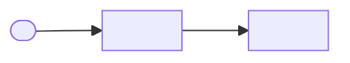
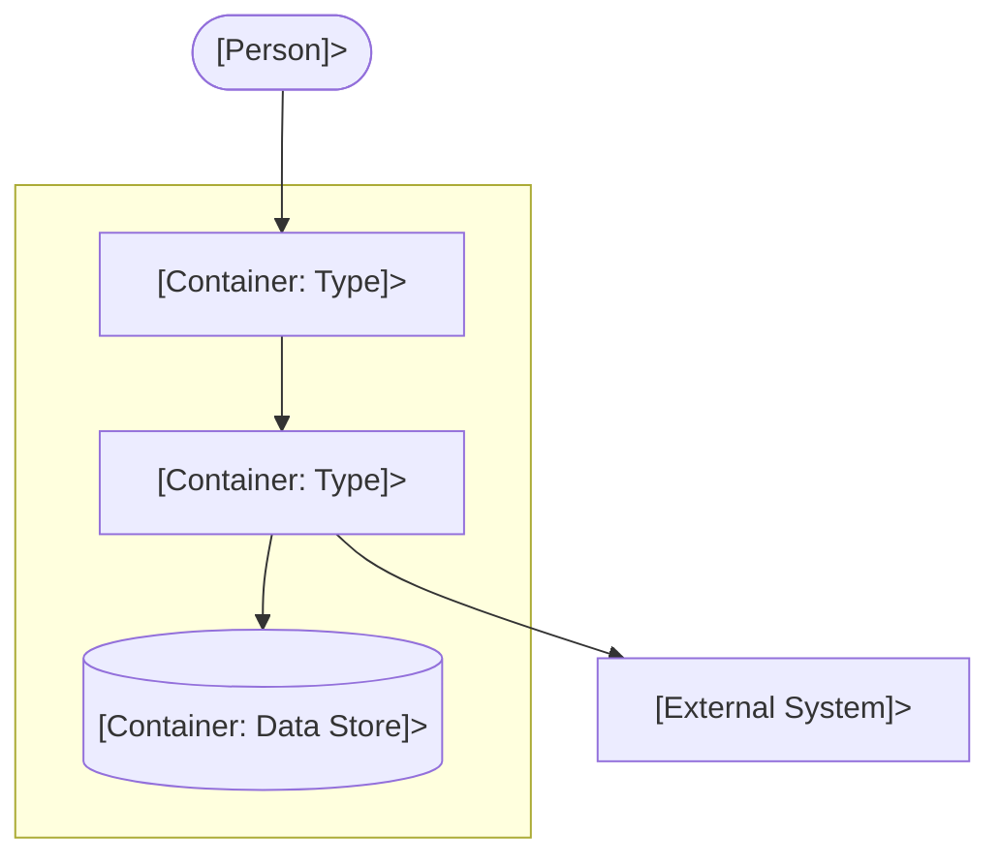
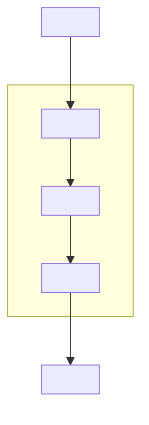
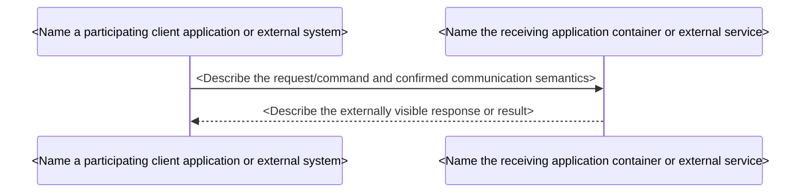
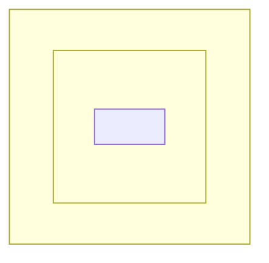

<!--
AUTHORING INSTRUCTIONS — DELETE THIS BLOCK IN THE OUTPUT

1. Every <...> is a fill-in instruction, not final document content. Replace
   the entire bracketed instruction with project-grounded text. Replace sample
   IDs, links and diagram nodes as well. Do not copy example statuses, dates,
   targets or values as facts. Short placeholders in tables are expanded by the
   guidance comments above them.
2. A section that truly does not apply says 'Not applicable: <Explain why the
   requirement or view is outside scope>'. Missing necessary information instead
   says 'Unverified: <Name the missing fact>; next action: <State who must verify
   it>'. Do not use 'Not applicable' to hide an unmet requirement, unknown risk
   or missing approval.
3. State the document's scope and whether diagrams/tables show as-is, transition
   or target. In a new system, label candidate design as proposed. 'addressed'
   means credible design coverage, not verified implementation.
4. Keep stable IDs: FUN-nn, QUA-nn, CST-nn, CNC-nn, DD-nn, FF-nn, ADR-NNNN.
   Reuse existing IDs in Evolve mode. Cite primary sources and link to decisions
   rather than repeating their reasoning.
5. Mermaid only where a diagram adds value. The diagrams below are editable
   skeletons, not verified examples of the user's architecture. Every retained
   diagram needs a title, state (as-is/transition/target) and readable legend.
6. Link to existing or newly proposed ADRs. Do not invent or mark decisions
   accepted without authorization. State FF status and evidence accurately.
-->

# System Design: <Name of the system or subsystem being designed>

## 1. Introduction and Goals

### 1.1 Requirements Overview

<!-- State the system purpose, target users and included/excluded scope briefly.
     List only architecturally significant functions. If none, state so explicitly. -->

<Summarize the system purpose, users, included/excluded scope and responsibilities relevant to its architecture>

| ID     | Significant Function                           | Source                    |
| ------ | ---------------------------------------------- | ------------------------- |
| FUN-01 | <Describe architecture-significant capability> | <Cite requirement source> |

### 1.2 Quality Goals

<!-- Select up to five leading quality goals for orientation; all quality
     scenarios remain in §10.2. Targets must come from confirmed drivers. -->

| Priority              | Quality Attribute        | Goal / Scenario IDs        |
| --------------------- | ------------------------ | -------------------------- |
| <Set agreed priority> | <Name quality attribute> | <State goal; link QUA IDs> |

### 1.3 Stakeholders and Concerns

<!-- List relevant roles and concerns. Use CNC ID only if the concern is a
     distinct architectural driver; otherwise reference FUN/QUA/CST. -->

| Stakeholder Role        | Concern                         | Driver / Source            |
| ----------------------- | ------------------------------- | -------------------------- |
| <Name stakeholder role> | <Describe architecture concern> | <Cite driver ID or source> |

### 1.4 Architectural Drivers

<!-- One row for every FUN/QUA/CST/CNC driver. Priority/Rank: order confirmed at
     Gate A (e.g. '1 / High'); constraints: 'Mandatory' (unranked). Unknown
     priorities remain unconfirmed rather than guessed. Difficulty:
     High/Medium/Low/Unknown. Design Status: addressed/gap/unverified/accepted-risk.
     'accepted-risk' requires explicit accountable approval and cannot bypass
     non-waivable hard constraints. Evidence kind/source goes in detailed sections;
     do not mistake an 'addressed' design for tested runtime behavior. Accepted-risk
     requires explicit human approval documented in §11. A DD is a deferred OPTION,
     not a substitute for fulfilling the driver. For CST, design coverage
     describes how the design accounts for it; §2 records meets/gap/unverified
     feasibility separately. -->

| ID     | Priority / Rank   | Difficulty          | Design Status         | Design / ADR          |
| ------ | ----------------- | ------------------- | --------------------- | --------------------- |
| QUA-01 | <Rank / priority> | <Assess difficulty> | <Set coverage status> | <Link element or ADR> |

<!-- Explain cross-driver tensions or unresolved approvals in prose immediately
     after the table. Source of each driver is in its detailed section. -->

## 2. Architecture Constraints

<!-- Hard constraints only; do not turn preferences into obligations.
     Assess each as 'meets', 'gap' or 'unverified' and cite the evidence.
     This obligation check is distinct from design coverage in §1.4. -->

| ID     | Constraint and Source               | Assessment                       |
| ------ | ----------------------------------- | -------------------------------- |
| CST-01 | <State fixed constraint and source> | <Record assessment and evidence> |

## 3. Context and Scope

### 3.1 Business Context

<!-- C4 System Context diagram if relationships need a visual. State system
     boundary, relevant people and external systems, and interaction purposes.
     Replace the example with real actors, external systems and directions;
     omit elements that do not exist or are immaterial to the current scope. -->

**Diagram — System Context (<Specify As-Is, Transition or Proposed Target as appropriate>):**

**Legend:** <Explain actor and system shapes, the system boundary, and what each arrow represents>

| External Actor / System               | Interaction                      |
| ------------------------------------- | -------------------------------- |
| <Name external actor/system and type> | <Describe exchanged information> |

### 3.2 Technical Context

<!-- Describe architectural external interfaces, trust boundaries and known
     communication protocol/style; avoid detailed API field contracts. -->

| Interface / System        | Direction and Data            | Protocol / Constraint       |
| ------------------------- | ----------------------------- | --------------------------- |
| <Name external interface> | <Describe direction and data> | <State protocol or unknown> |

## 4. Solution Strategy

### 4.1 Architecture Style and Partitioning

<!-- Briefly state the as-is baseline (if any), selected target style,
     partitioning rationale, modules, release boundaries, important data
     ownership and key coupling. Architectural quantum analysis is optional;
     refer to ADRs rather than repeating their reasoning. -->

- **Current State:** <Summarize observed current boundaries and cite evidence, or state not applicable to greenfield>.
- **Target Structure:** <Name the chosen structure, module/service boundaries, data ownership and driver-based rationale>.
- **Release/Coupling Boundaries:** <Explain release coupling and coordination; discuss architectural quanta only when consequential>.
- **Decision Basis:** <Reference the ADRs, mandated constraints or observed evidence supporting the strategy>.

### 4.2 Key Technology Decisions

<!-- Record only technologies with architectural impact. Distinguish
     mandated choices (CST), retained existing choices (observed source),
     proposed selections (ADR), and open choices (DD or unresolved blocker).
     Keep evaluation rationale in the ADR; do not list routine dependencies,
     fabricate alternatives or invent versions. -->

| Architectural Concern  | Choice                   | Basis                    |
| ---------------------- | ------------------------ | ------------------------ |
| <Architecture concern> | <Technology / undecided> | <ADR/CST/DD or evidence> |

### 4.3 Evolution Strategy

<!-- For an existing-system migration, replace each step with project-specific
     phases, identifying compatibility, authoritative data, consumers,
     verification, cutover, recovery and retirement. Adapt the number of
     phases to the migration; do not force four stages when inappropriate.
     For greenfield designs, remove the migration steps and briefly describe
     change-ready boundaries if driven by requirements. Otherwise use
     'Not applicable: No migration is required for this new design.'
     Remove the Change Objective and all migration-step placeholders if there
     is no migration. -->

**Change Objective:** <Identify the drivers and the specific architecture change being planned>.

1. **Prepare:** <Describe the compatibility boundary, prerequisite and proof needed before changes>.
2. **Transition:** <Describe the incremental switch, consumer compatibility and authoritative data flow>.
3. **Cut Over:** <Specify cutover evidence, authorized checkpoint and rollback or forward-recovery path>.
4. **Retire:** <Identify retirement proof, consumer exit criteria and approving owner role>.

### 4.4 Deferred Decisions

<!-- List only optional architecture decisions with a viable interim design,
     accountable owner and an observable revisit trigger. Repeat the whole H4
     subsection for each DD row, preserving the same ID in table and details.
     A deadline can be a latest-safe milestone or condition, not necessarily a
     calendar date; it must be justified by the decision risk. A revisit signal
     is not automatically an FF. If none are deferred, replace the table and
     details with 'Not applicable: No optional architecture choices are deferred.' -->

| ID    | Related Driver        | Choice Deferred   | Revisit Condition            |
| ----- | --------------------- | ----------------- | ---------------------------- |
| DD-01 | <Affected driver IDs> | <Deferred choice> | <Observable revisit trigger> |

#### DD-01: <Name the deferred architectural decision>

- **Reason and Interim Approach:** <Explain why the decision can be postponed and how the interim architecture remains viable>.
- **Options and Change Risk:** <Summarize likely alternatives, reversal cost, migration implications, and risks of postponement>.
- **Decision Deadline:** <Specify the latest safe milestone, date, or condition by which the decision must be made>.
- **Owner and Next Step:** <Identify the accountable role and the investigation, evaluation, or action required before deciding>.
- **Revisit Signal / Fitness Function:** <Describe the condition that triggers reconsideration and reference an FF ID only when an actual fitness function monitors it>.

## 5. Building Block View

### 5.1 Container View

<!-- Show architecturally significant C4 applications and data stores within
     the system boundary and relevant actors/external systems outside it.
     Replace the example topology: add or remove nodes and relationships to
     match the actual design. State known technologies and interaction styles;
     mark open decisions rather than guessing. A C4 container is not necessarily
     a separately released artifact. For large systems, use an overview and
     focused views rather than one giant flowchart. -->

**Diagram — Container View (<Specify As-Is, Transition or Proposed Target as appropriate>):**

**Legend:** <Define system boundary, container shapes, ownership and direction of interactions>

| Container        | Responsibility           | Technology               | Data Ownership      |
| ---------------- | ------------------------ | ------------------------ | ------------------- |
| <Container name> | <Primary responsibility> | <Technology / undecided> | <Owned data / none> |

### 5.2 Component View: <Name the C4 container being decomposed>

<!-- Add a Component View only when decomposition of a significant C4
     container clarifies architectural responsibilities, interfaces or
     dependencies. Repeat this entire H3 subsection as 5.3, 5.4, etc. for
     each additional container that needs a Component View. Remove this
     subsection entirely when no component-level view adds value.
     The diagram is a replaceable skeleton, not a required component pattern:
     keep only the components and external participants that actually matter.
     Keep component names, relationships and boundaries consistent with §5.1;
     components inside one C4 container are not separate C4 deployment units. -->

**Diagram — Component View (<Specify As-Is, Transition or Proposed Target as appropriate>):**

**Legend:** <Identify the decomposed container boundary, internal components, external participants and direction/purpose of dependencies>

| Component        | Responsibility         | Interface / Dependency                |
| ---------------- | ---------------------- | ------------------------------------- |
| <Component name> | <Owned responsibility> | <Exposed contract / key dependencies> |

## 6. Runtime View

<!-- Include only scenarios that explain an architecturally significant
     decision, external interaction, consistency rule or failure response.
     If none adds value at this scope, remove the illustrative H3/diagram and
     state 'Not applicable: <specific reason>'. -->

### 6.1 <Name the runtime scenario that reveals an architectural choice or failure mode>

**Scope:** <Specify whether this behavior is observed, transitional or proposed>; **Drivers:** <List functional or quality driver IDs demonstrated by this scenario>.

- **Success And State:** <Explain the successful flow, state owner and required consistency semantics>.
- **Failure And Recovery:** <Explain relevant failure handling, recovery and consumer-visible outcome>.
- **Verification:** <Reference the validation method/FF and distinguish planned from observed evidence>.

## 7. Deployment View

<!-- Map relevant logical C4 containers to deployment nodes/instances in a
     specific environment. For greenfield, label the deployment as proposed.
     Do not invent nodes, counts or zones when deployment is undecided; instead
     state the gap, assumption and next architectural decision. Client-side
     applications may run on user devices; external services remain external. -->

**Diagram — Deployment View (<Name the environment and identify its observed or proposed state>):**

**Legend:** <Explain runtime-node groups, instance shapes and represented network edges>

| Node / Zone   | Container Instance   | Isolation / Scaling   | Evidence           |
| ------------- | -------------------- | --------------------- | ------------------ |
| <Node / zone> | <Container instance> | <Isolation / scaling> | <Source / unknown> |

## 8. Crosscutting Concepts

<!-- If none, write 'Not applicable: No shared architectural policy is needed
     beyond decisions already documented.' Otherwise one H3 per concept. -->

### 8.1 <Name the policy shared across multiple architecture elements>

- **Purpose/Drivers:** <Cite the affected driver IDs and why a shared policy is required>.
- **Applies To:** <List the exact architecture elements governed by this policy>.
- **Rules And Mechanism:** <Specify the architectural rule, ownership and cross-boundary mechanism>.
- **Failure/Exceptions:** <Explain required exception approval, detection or failure response, if applicable>.
- **Decision/Verification:** <Reference the governing ADR and any FF with actual execution status>.

## 9. Architecture Decisions

<!-- List relevant ADR files with verified relative paths, titles and status.
     Replace the sample ADR path/ID with a real link. If no ADR is applicable,
     explain briefly; do not invent a new record or an accepted status. -->

| ADR                                       | Decision                | Status                    |
| ----------------------------------------- | ----------------------- | ------------------------- |
| [ADR-0001](decisions/0001-short-title.md) | <Copy actual ADR title> | <State actual ADR status> |

## 10. Quality Requirements

### 10.1 Quality Requirements Overview

<!-- Lightweight tree: quality attribute → relevant scenario IDs. Do not
     repeat entire scenario details in the overview. -->

- **<Name the agreed quality attribute used by these scenarios>:** QUA-01 (<Summarize the quality scenario without repeating its full details>)
- **<Name another relevant quality attribute or remove this sample item>:** <List its QUA scenario IDs or omit this entry if none>

### 10.2 Quality Scenarios

<!-- One H4 per quality driver; write all SIX scenario parts. Require an
     observable criterion or explicitly 'Target unconfirmed' and action.
     Source-of-requirement provenance is separate from stimulus source. -->

#### QUA-01 — <Name the quality attribute and the distinguishing scenario condition>

- **Requirement Source:** <Cite who established the need or where it is recorded>.
- **Stimulus Source:** <Identify the source of the stimulus, such as a user or dependency>.
- **Stimulus:** <Describe the precise triggering event or change request>.
- **Environment:** <Specify relevant workload, system state and measurement window>.
- **Artifact:** <Name the boundary, data or architectural element that responds>.
- **Response:** <Describe the observable system response to the stimulus>.
- **Response Measure:** <State the agreed measurable limit and observation window, or mark target unconfirmed>.
- **Evidence:** <Identify evidence type, source, environment and known limitations>.
- **Design Coverage:** <Link the proposed design/ADR and assign justified coverage status>.

### 10.3 Fitness Functions

<!-- List fitness functions in the overview table and repeat the entire H4
     subsection for each FF ID. Include only checks guarding consequential
     architectural characteristics, not one per driver/ADR. Execution state
     is planned / active / suspended; active requires evidence of an operating
     check. Record the last result separately as pass / fail / not-run / unknown.
     For a planned check with no execution, use not-run. If no check is justified
     or feasible, remove the table and details, state why and describe how the
     critical property will otherwise be reviewed or validated. -->

| ID    | Guards                          | Execution State       | Check / Location                     |
| ----- | ------------------------------- | --------------------- | ------------------------------------ |
| FF-01 | <List guarded driver / ADR IDs> | <Set execution state> | <Describe check and execution stage> |

#### FF-01 — <Name the architectural characteristic being protected>

- **Method and Data:** <Describe inspected artifacts or observations, data source and environment>.
- **Criterion:** <Specify objective pass/fail criterion, measurement period and approved source>.
- **Cadence and Owner:** <Define execution cadence and accountable owner role>.
- **On Failure:** <Specify who responds and whether a failure blocks, alerts or triggers review>.
- **Last Result and Evidence:** <Record pass/fail/not-run/unknown, execution date/source if available, and evidence limits or activation gap>.

## 11. Risks and Technical Debt

<!-- Include architecture residual risks, accepted shortfalls, temporal
     transition debt and unverified assumptions. If empty, state based on
     reviewed scope rather than claiming zero risk globally. -->

| ID / Type   | Risk / Debt             | Impact / Driver          | Mitigation / Owner              |
| ----------- | ----------------------- | ------------------------ | ------------------------------- |
| R-01 / Risk | <Describe risk or debt> | <State impact; cite IDs> | <Describe mitigation and owner> |

<!-- For accepted risk, identify accountable authorization, accepted scope,
     mitigating controls and review condition. Hard compliance constraints must
     remain unmet unless the actual requirement is formally changed. -->

## 12. Glossary

<!-- Define only domain/architecture terms with ambiguous local meaning.
     Include context-specific meanings where they differ. -->

| Term                         | Meaning                           |
| ---------------------------- | --------------------------------- |
| <Name ambiguous system term> | <Define project-specific meaning> |
