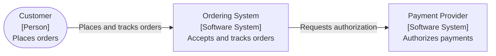
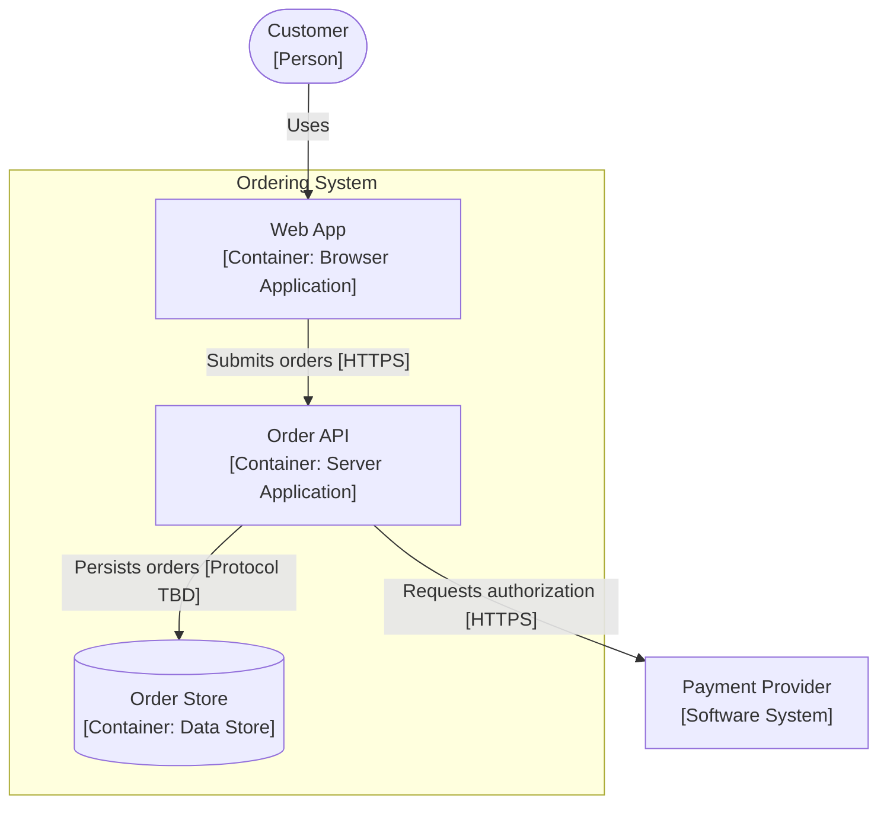
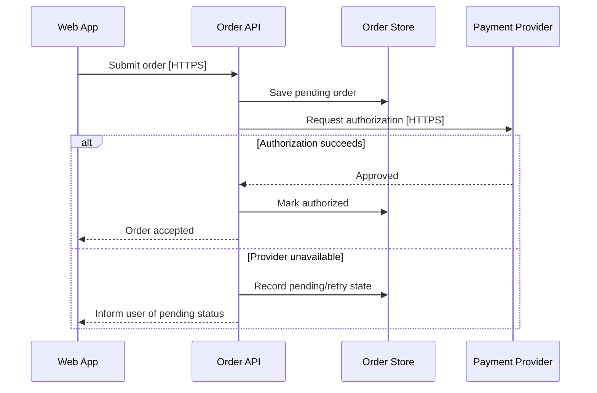
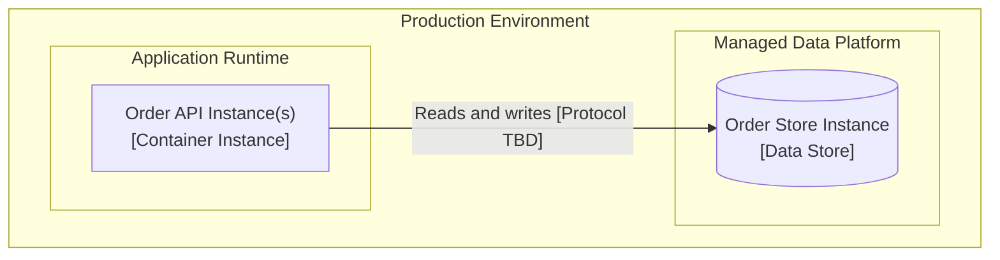

# Views and Diagrams

Use to document an architecture in forms that answer stakeholder concerns. The arc42 document organizes why and what; C4 supplies useful structural abstraction levels. Neither requires drawing every possible diagram. Mermaid is the default representation where accepted by the project.

## C4 Element Vocabulary

| Element         | Meaning                                                | Common Confusion                                |
| --------------- | ------------------------------------------------------ | ----------------------------------------------- |
| Person          | Human interacting with a software system               | A team is a stakeholder, not necessarily a user |
| Software System | A system that delivers value; in or outside scope      | External systems stay outside the boundary      |
| Container       | Application or data store within a software system     | Not synonymous with Docker/container image      |
| Component       | Grouping of related functionality within one container | Not automatically a deployable service          |
| Deployment Node | Runtime/infrastructure location and nested nodes       | Not a C4 container                              |

Examples of C4 containers include server applications, browser SPAs, mobile apps, databases, queues or data stores depending on modeled responsibilities. A database server may host multiple logical stores; a single application may have many runtime instances. Do not confuse the **logical Container View** with the **physical Deployment View**.

## Select Views by Concern

| System Design Section          | View             | Question Answered                                       |
| ------------------------------ | ---------------- | ------------------------------------------------------- |
| §3 Context and Scope           | System Context   | Who/what interacts with the system?                     |
| §5.1 Container View            | Container        | Which major applications/stores exist and connect?      |
| §5.2 Component View (optional) | Component        | How does a high-risk container divide responsibilities? |
| §6 Runtime View                | Dynamic/sequence | What happens in one important scenario/failure?         |
| §7 Deployment View             | Deployment       | Where/how do logical containers run and fail?           |

Start with system context and container views where architecturally meaningful. Add component views only to resolve important design decisions; choose runtime scenarios that reveal communication, state and failure semantics. Draw production deployment where relevant, adding other environments only if their architectural differences matter.

For a large system, split by a clear bounded domain/subsystem and keep one overview; team boundaries can influence scope but need not define system boundaries. Reuse names/IDs consistently across diagrams; show external dependencies rather than pretending they are owned by the system.

## Notation and Accuracy

- Every diagram has a **title and scope**, plus a **concise legend** if shapes/lines/colors are non-obvious or custom.
- Name each element and state its responsibility/type; include technology **only if** known and decision-relevant. Use `Not yet selected` where an open architecture-level choice exists; do not name speculative products.
- Use directional edges with purpose and, for cross-container communication, known protocol/style. Do not fabricate a protocol from intuition.
- Distinguish **current**, **transition** and **target** diagrams explicitly; do not merge them without a clear legend.
- For distributed failures, represent retry/timeout and recovery in runtime text or diagrams where they materially affect a driver.
- Prefer plain Mermaid `flowchart` and `sequenceDiagram` for portability. Mermaid's optional C4 syntax is not required. Check syntax against the renderer available in the project when possible.
- C4 is notation-independent; diagram labels and legends convey the abstractions. Do not claim a Mermaid flowchart automatically conforms to every C4 notation recommendation.

## Context Example

Illustrative project, not a mandated design:

**Legend:** rounded = person; rectangular = software system; directed arrows = interactions. The payment provider is outside the system under design. State the system boundary in the surrounding caption or with a subgraph if needed.

## Container Example

**Legend:** rounded = person; rectangle = application/external system; cylinder = data store; subgraph = owned system; directed arrows = interactions. Protocol `TBD` is an explicit unconfirmed design item and must be recorded as such if consequential.

## Runtime Scenarios

Select representative successful, degraded and recovery cases where their distinct behavior matters. For each record the drivers, stimulus/environment, participating containers, dependency semantics, state transitions, timeouts/retries/idempotency as applicable, externally visible result and verification.

## Deployment View

Show the selected environment, runtime nodes, logical container instances, stateful dependencies, network/trust boundaries and scaling/failover placement when significant. Map logical containers from §5 to one or more deployment nodes, including client-side applications and managed data stores where appropriate. Do not require an owned infrastructure node for an external provider.

**Legend:** nested groups = deployment nodes; rectangle = application instance; cylinder = store instance; directed arrow = runtime connection. Counts and availability zones should be specified only if known or required by drivers.

## Changes Across Views

When an existing system evolves, a logical container may remain the same while its deployment changes, or a module may be extracted into a new logical container. Record the _actual changed dimension_ and label diagrams accordingly:

- **Current (as-is):** observed software and deployment evidence, not assumed historical intent.
- **Transition:** temporary adapters, coexistence, data replication or routing; show the authoritative writer and the condition for leaving this state.
- **Target:** approved or proposed end state; clearly identify whichever status applies.

**Example:** an existing `Ordering App` moves from one runtime node to several replicas without changing its C4 container responsibilities. Revise the deployment view; do not invent multiple logical C4 containers just because runtime instances multiply. If a worker becomes a separately owned application, then revise the container and runtime views as well.

## Documentation Consistency Checks

- Each view has explicit scope, target audience and current/target state.
- Every owned container in the logical model has a deployment mapping **or an explained exception** (e.g. browser app deployed to a user's device).
- Referenced runtime participants and dependencies exist in the context/container views; a runtime scenario need not show **every** container.
- External systems and people appear where relevant; no claim that all appear in every diagram.
- Interfaces, data ownership, trust boundaries and technology labels agree with ADRs and architecture concepts.
- One diagram should answer one important question; do not add detailed class diagrams to fill space.
