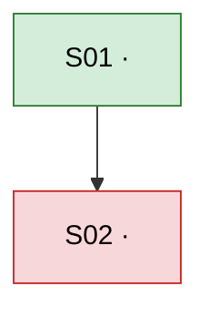

<!-- comment: Every comment in this template is an instruction to the agent. Follow the generation rules in SKILL.md (Output section), then delete all comments from the generated Slice Plan. -->

# Slice Plan: <Work Item title>

<!-- comment: Copy the Work Item's own title exactly as its source states it. Do not reword or shorten. -->

> **Source:** <Work Item reference>  
> **Mode:** <Flat or Recursive>  
> **Created:** <YYYY-MM-DD>  
> **Last synced:** <YYYY-MM-DD>

<!-- comment:
Source: the Work Item's own reference exactly as the project identifies it (identifier, link or file path). For a Slice taken from another Slice Plan, give that plan's path and the Slice ID. If the Work Item was given only as text in the request, write one line stating where it came from.
Mode: exactly one of Flat or Recursive, as chosen with the human.
Created: date the plan was first saved. Never changed afterwards.
Last synced: date of the most recent Sync. Equal to Created until the first Sync.
Format: one field per line in one blockquote; field name and colon bold, value after. Two trailing spaces on all but the last line.
-->

## Work Item

<!-- comment: Describe the Work Item so that a reader who has never seen the original understands the plan on its own. Every statement here must come from the Work Item or from answers the human confirmed (Step 2, or the Sync flow for added scope). Nothing may be inferred. -->

**Outcome:** <One paragraph: what the Work Item delivers once fully done, stated as observable results for whoever uses or operates it.>

**Boundary:**

- **Included:** <Parts, behaviors and areas the Work Item is responsible for, this defines "full depth" for every Slice.>
- **Excluded:** <Parts, behaviors and areas explicitly outside the Work Item, as confirmed by the human.>

**References:**

| ID  | Document         | Location       | Defines                              |
| --- | ---------------- | -------------- | ------------------------------------ |
| R1  | <Document title> | <path or link> | <What it defines for this Work Item> |

<!-- comment:
Only when applicable. Omit the heading and table when the Work Item has no supporting documents.
Registers every document outside this plan (specification, design, convention, decision record) that Slices must follow. One row per document, each with a permanent ID R1, R2, ... that is never reused.
Document: the document's own title.
Location: repository path or link, verified accessible.
Defines: names precisely which aspects of the Work Item the document governs, so each Slice can point to the narrowest relevant part instead of the whole document.
Only list documents the human provided or confirmed (Step 2, or the Sync flow for added scope).
-->

**Contract:** <Only when applicable (Contract-first): the agreed interface between independent parties, stated precisely enough that each party can implement and verify against it alone. Omit this entry otherwise.>

## Progress

<!-- comment: Derived. Regenerate from the Slices on every save. Counts must equal the number of Slices with that Status or Granularity. -->

| Total | READY | BLOCKED | IN-PROGRESS | DONE | Atomic | Coarse |
| ----- | ----- | ------- | ----------- | ---- | ------ | ------ |
| <n>   | <n>   | <n>     | <n>         | <n>  | <n>    | <n>    |

## Dependency Graph

<!-- comment:
Derived. Regenerate from each Slice's "Depends on" and Status on every save.
One node per Slice: S01["S01 · Title"]. Inside labels, replace double quotes with single quotes and remove line breaks and angle brackets.
Edge A → B means A is a prerequisite of B (B lists A in "Depends on").
Assign every node to exactly one class matching its Status: ready, blocked, inProgress, done.
-->

## Execution Order

<!-- comment: Derived. A Slice is in Wave 1 when it has no Dependencies; otherwise in the Wave that is 1 plus the highest Wave among its Dependencies. Slices in the same wave can run in parallel; write them in one cell separated by  . Within a wave, list Risk-first Slices first (when that technique applies), otherwise by ID. -->

| Wave | Slices                         |
| ---- | ------------------------------ |
| 1    | S01 · <Title>                  |
| 2    | S02 · <Title> S03 · <Title> |

## Slices

<!-- comment: Source of truth for Status, Granularity and Dependencies. List Slices in ID order. -->

### S01 · <Title>

<!-- comment: ID is permanent and never reused. Title is a verb followed by one single outcome; it must not join two behaviors with "and" or "or". -->

| Field         | Value                                 |
| ------------- | ------------------------------------- |
| Status        | <READY, BLOCKED, IN-PROGRESS or DONE> |
| Granularity   | <Atomic or Coarse>                    |
| Coarse reason | <Unmet Scope Signal or guard reached> |
| Depends on    | <S00 — reason; S00 — reason> or —     |

<!-- comment:
Status: exactly one of the four values, following the Status Rules below.
Granularity: Atomic when the Slice meets the full Slice Quality Bar. Coarse otherwise.
Coarse reason: include this row only when Granularity is Coarse; omit the row otherwise. Name the unmet Scope Signal (by number and wording) or the guard reached (G3 or G4). In Flat mode state that no further Split was attempted.
Depends on: entries separated by semicolons, each formatted "S0n — why this Slice cannot start or be verified without it". Hard prerequisites only. Write — when there are none.
-->

**Outcome:** <One short paragraph: the observable result once this Slice is done, stated so a reader can recognize it without reading the Acceptance Criteria.>

**In scope:**

- <Behavior or part this Slice delivers, within the Work Item's Boundary.>

**Out of scope:**

- <Related behavior or part this Slice does not deliver> (→ S0n)

<!-- comment: Every exclusion that belongs to another Slice names that Slice's ID. An exclusion that belongs to no Slice is also outside the Work Item's Boundary and must be listed there. -->

**References:**

- R1 §<section or identifier> — <What this Slice takes from it>

<!-- comment:
Only when applicable. Omit when no Work Item Reference governs this Slice.
Point to the narrowest part (section, heading, identifier) of a Work Item Reference that defines this Slice's behavior. The ID must exist in the Work Item's References.
Acceptance Criteria must agree with the referenced part. If they conflict, stop and ask the human; do not choose one silently.
-->

**Acceptance Criteria:**

- [ ] <One binary, observable condition.>

<!-- comment:
One condition per line. Each states a precondition (when relevant) and the expected observable result, so it can only be judged pass or fail.
Use concrete values, thresholds and named outcomes. Avoid vague words such as "properly", "fast", "correctly", "appropriate", "etc.".
Together the criteria must cover everything in "In scope" and nothing from "Out of scope".
A Slice meeting the Quality Bar normally has no more than 5.
-->

**Verification:**

- <Command or manual step> → <expected observation>

<!-- comment: Prefer the verification commands defined by the project (test, build, lint, type-check). If none applies, write a manual check with exact steps and the exact observation that counts as passing. Every Acceptance Criterion must be covered by at least one line. -->

## Slicing Log

<!-- comment:
Append-only. One row per Split.
Parent: "Work Item" for the first Split and for scope added at Sync; otherwise the ID of the Slice that was split, or its title when it is an intermediate Slice that was split further and therefore has no ID in this plan.
Technique: the catalog name exactly as written in the skill. When the Work Item, or the scope added at Sync, already met the Slice Quality Bar and was not split, write "None (already meets the Quality Bar)".
Result: IDs of the final Slices produced; titles for intermediate Slices that were split further. Log only Splits that actually happened.
-->

| #   | Date         | Parent    | Technique   | Result   |
| --- | ------------ | --------- | ----------- | -------- |
| 1   | <YYYY-MM-DD> | Work Item | <Technique> | S01, S02 |

## Status Rules

<!-- comment: Fixed text. Copy verbatim, do not edit. -->

Statuses a Slice can have, and what each one means:

| Status      | Meaning                                                             |
| ----------- | ------------------------------------------------------------------- |
| BLOCKED     | At least one Dependency is not DONE.                                |
| READY       | All Dependencies are DONE (or none exist) and work has not started. |
| IN-PROGRESS | Work has started.                                                   |
| DONE        | Every Acceptance Criterion is checked and Verification has passed.  |

Allowed status changes and the event that triggers each one:

| From        | To          | When                                                               |
| ----------- | ----------- | ------------------------------------------------------------------ |
| BLOCKED     | READY       | The last Dependency becomes DONE.                                  |
| READY       | BLOCKED     | A Dependency that is not DONE is added to the Slice.               |
| READY       | IN-PROGRESS | Work begins.                                                       |
| IN-PROGRESS | DONE        | Every Acceptance Criterion is checked and Verification has passed. |
| IN-PROGRESS | READY       | Work is stopped before completion.                                 |

No other transitions exist. DONE is final. Defects found after DONE are added as new Slices.
